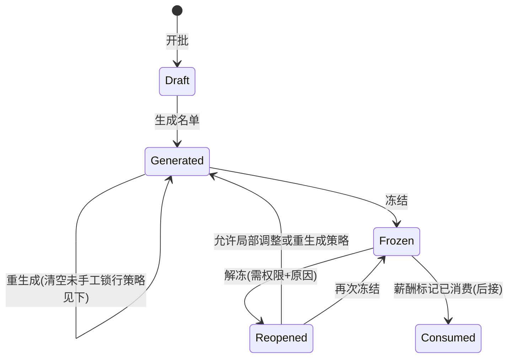

# 人事月报 — 需求与详细设计方案

> 分析日期：2026-11-11  
> 设计立场：**人力资源管理专家方案**；对齐当前 EHR（人员 / 异动 / 离职 / 停职 / 公司参数 / 管辖），**不以项目内老系统窗体或字段为蓝本**  
> 状态：**待批准**  
> 平台落点：人事管理下独立业务模块；产出「发薪前人事关账快照」，供薪酬后接消费

---

## 1. 意图与为什么现在做

人事月报不是看板，也不是保险月报、不是 `reportDef` 界面定义。它是**薪酬计算前的人事事实底稿**：在一个明确的薪酬月内，把「谁该进算薪」和「算薪要用的人事事实」一次钉死，再交给薪酬。

当前系统已具备人员主档、异动、离职（含薪资结算指令）、停职、公司参数中的考勤/薪资月界字段，但：

- 考勤业务模块仍为空壳（仅有菜单目录）；
- 无薪酬引擎、无发薪主体/薪资组一等公民；
- 离职指令已按 `pay_period` 落库，却无人消费、也无人做「整月人事关账」。

成功标准：

1. HR 在**人事管理 → 人事月报**完成：选厂别/薪酬月 → 生成名单 → 校验调整 → **冻结**。  
2. 冻结后形成**不可随意漂移的快照**，作为薪酬读取的权威人事输入（一期至少可导出/API 拉取）。  
3. **不存**应出勤/实出勤/请假/加班等工时结果（归**考勤月报**）；但保留考勤月界、考勤起止日、入离职日及参数快照等，供考勤月报计算。  
4. 管辖、厂别解析、多语言、列表排序与高级查询均遵循项目既有规则。

---

## 2. 已确认业务结论

| # | 结论 | 来源 |
|---|------|------|
| C1 | 定位：成本与计薪名单导向；**主交付为薪酬提供计薪名单与人事事实** | 产品确认 |
| C2 | 一期做「关账名单 + 计薪事实」；菜单挂**人事管理** | 产品确认 |
| C3 | 不以老系统为参考；专家方案 + 钉在当前 EHR 能力上 | 产品确认 |
| C4 | **工时结果归考勤月报**；人事月报去掉应出勤/实出勤/请假天/加班小时等；**保留考勤月报计算所需输入字段** | 产品确认 |
| C5 | 现有 `reportDef` / 保险「月报」参数**不复用为**本模块 | 专家建议 |
| C6 | 一期不算薪、不发薪；只产出契约数据 | 专家建议（对齐离职指令模式） |
| C7 | 人事月报会涵盖人事资料字段；人事资料为**动态字段池**（`hr_ui_field_def`），月报须按配置快照，禁止只写死一截静态列 | 产品确认 |
| C8 | 异动可改字段亦为**自定义配置**（`hr_emp_chg_field` ↔ 人事 FieldKey）；月报月内异动轨迹须跟配置走，禁止只写死部门/岗位 | 产品确认 |

### 2.1 设计方默认（可在批准时推翻）

| # | 默认 | 说明 |
|---|------|------|
| D1 | 业务键粒度 = **`SiteCode` + `PayPeriod`（yyyyMM）** 一份月报批次 | 与 `HrCompanyParam` / 离职 `pay_period` 对齐；跨公司不可混批 |
| D2 | 薪酬月日历由公司参数推导：`AttCloseDay` + `PayrollAttMonth` | 见 §6；缺参则报错，不猜 |
| D3 | 名单默认纳入规则见 §7；允许人工**纳入/排除**并强制原因码 | 关账允许例外，但必须可审计 |
| D4 | **冻结后默认只读**；解冻须权限 + 原因；薪酬已消费后禁止静默解冻 | 见 §8 |
| D5 | 成本一期快照**行政部门 `cc_code`**（及可选显示名）；正式成本中心/发薪主体后置 | 避免假造主数据 |
| D6 | 模块码 `hrEmpMonth`；表前缀 `hr_emp_month_*` | 与 `hrEmp` / `hrEmpLeave` 命名一致 |
| D8 | **P0 名单算法简化**：用主档入职/离职日、当前状态、本月 `pay_cmd`、窗口内已生效异动/停职**标记**；**不做**逐日在职区间回放（P1 再增强） | 降低一期工期；Warn 提示「月内有异动请人工核对」 |
| D9 | P0 实现 `MarkConsumed` 幂等写状态；**不做**服务间鉴权增强；无薪酬模块时可不起用 | 契约先留口，避免假安全 |
| D10 | 人事月报**不**落工时结果列；考勤窗与人员考勤资格字段作为对考勤月报的只读输入契约 | 与 C4 一致 |
| D11 | **月底最终状态 = 异动后（已生效）**：`CcCode`/`PostId`/`DutyId`/`EmpSal`/`CostCcCode` 等主快照取窗口末日已生效写回后的主档值；**不取**异动前。异动前只落在期初/摘要类字段 | 见 §7.6 |
| D12 | 人事属性快照 = **hrEmp 字段池白名单 + 场景 `monthSnap`**；值写入 `EmpFieldSnapshot`；不另造字段字典、不做池外 EAV | 见 §7.7 |
| D13 | 月内异动轨迹 = **启用中的 `hr_emp_chg_field`**（FieldKey∈人事池）∩ 窗内已生效异动明细；写入 `ChgFieldSnapshot`；期末主档仍按 §7.6 | 见 §7.8 |

---

## 3. 目标 / 非目标 / 反目标

### 3.1 一期目标

| 能力 | 说明 |
|------|------|
| 月报批次 | 按厂别 + 薪酬月开批；解析月界；状态机 |
| 生成名单 | 按规则从人员主档 + 期间事件拉入行；幂等可重生成（未冻结） |
| 行级事实 | 月报固有列（纳入/考勤输入/指令等）+ **按配置快照的人事资料动态字段**（见 §7.7） |
| 校验 | 缺部门、缺入职日、期间内未生效离职/异动冲突、重复工号、管辖外残留等 |
| 调整 | 人工纳入/排除、改备注；不可改工号；**不提供工时录入** |
| 冻结 / 解冻 | 冻结出「薪酬可读版本」；解冻受控 |
| 导出 / API | Excel 导出；`GetFrozen` / `ListLines` 供薪酬后接 |
| 列表基建 | 服务端排序、高级查询、组织树筛选面板、多语言 UI |

### 3.2 非目标（一期不做）

| 不做 | 说明 |
|------|------|
| 打卡、日结、排班、假勤引擎 | 考勤模块另案 |
| **考勤月报及工时结果** | 应出勤/实出勤/请假/加班等由**考勤月报**计算与存放；人事月报不存、不录入 |
| 算薪 / 个税 / 实发 / 工资条 | 只提供人事输入契约 |
| 发薪主体、薪资组、成本中心主数据 | 文档预留列位；一期不建完整主数据 |
| 保险月报 | 公司参数 `InsMonthReportMode` 属保险域，禁止混用 |
| 把月报塞进 `reportDef` 布局器 | 职责不同 |
| 自动关账 Job（可选二期） | 一期以人工「生成→冻结」为主；可预留定时生成草稿 |
| 复杂分摊引擎 / 多成本中心拆分比例 | 成本一期 = 部门归属快照 |
| 脱离 `hr_ui_field_def` 另维护一套「月报人事字段字典」 | 与人事资料动态定义双轨，禁止 |
| 异动轨迹写死仅部门/岗位 | 忽略 `hr_emp_chg_field` 自定义可改项，禁止 |

### 3.3 反目标

- 每月直接「现查主档」给算薪、无冻结点 → 发薪后人事改档导致对不上账。  
- 把未审核/未生效的异动、离职当成已发生事实写入月报。  
- 管辖外人员进入可冻结名单。  
- 冻结后仍随主档自动漂移。  
- 与保险月报、界面报表定义共用一套菜单与表。  
- 在人事月报中维护应出勤/实出勤/加班等工时（抢考勤月报职责）。

---

## 4. 在系统中的位置

```text
人事管理
├── 人员资料 / 异动 / 离职 / 停职 …     ← 事实源（发生制）
├── 公司参数设置                         ← 月界与考勤规则参数
└── 人事月报（本模块）                   ← 期间人事关账快照
         ├─→ 薪酬模块（后接）：计薪名单 + 人事事实
         └─→ 考勤月报（后接）：只提供计算输入（月界/资格/入离职日等）
                └─→ 工时结果留在考勤月报，不回写人事月报
```

| 现有能力 | 与月报关系 |
|----------|------------|
| `h_emp_mstr` | 名单与基础事实源 |
| `hr_emp_chg` + 生效 | 月内部门/岗位等变更事实 |
| `hr_emp_leave` + `hr_emp_leave_pay_cmd` | 离职与结算码；按 `pay_period` 关联 |
| `hr_emp_suspend` | 停职是否计薪需行上标记（规则见 §7） |
| `HrCompanyParam` | `AttCloseDay` / `PayrollAttMonth` / 入离职日考勤等 → 批次参数快照 |
| `HrCompanySiteResolveService` | 部门 → `SiteCode`；批次厂别权威 |
| `HrUserCcScopeService` | 人事管辖过滤 |
| `reportDef` | **无关**；勿挂月报业务 |
| `hr_ui_field_def` / scene | 人事资料动态字段源；月报用 `monthSnap` 勾选后快照（§7.7） |
| `hr_emp_chg_field` + `hr_emp_chg_line` | 异动自定义可改项与前/后值；月报轨迹进 `ChgFieldSnapshot`（§7.8） |
| 考勤月报（另案） | **消费**本模块冻结数据中的考勤计算输入；产出工时 |

---

## 5. 业务对象与状态机

### 5.1 对象

| 对象 | 中文名称 | 说明 |
|------|----------|------|
| `HrEmpMonthBatch` | 人事月报批次 | 某厂别 + 薪酬月的关账头 |
| `HrEmpMonthLine` | 人事月报行 | 一人一行快照；含纳入状态、人事事实、考勤计算输入、校验标记 |
| `EmpMonthExcludeReason` | 月报排除原因 | 码表 |
| `EmpMonthIncludeReason` | 月报纳入原因 | 码表 |
| 操作日志（建议） | 月报操作日志 | 生成、重生成、冻结、解冻、行调整关键审计 |

### 5.2 批次状态



| 状态值 | 中文名称 | 含义 | 允许操作 |
|--------|----------|------|----------|
| `Draft` | 草稿 | 已开批，未生成 | 改备注、删除空批、生成 |
| `Generated` | 已生成 | 已有行，可调 | 调整行、校验、重生成、冻结 |
| `Frozen` | 已冻结 | 关账只读 | 导出、API 读取；解冻（权限） |
| `Reopened` | 已解冻 | 解冻后 | 同已生成；再次冻结 |
| `Consumed` | 已消费 | 薪酬已拉取/关账 | 默认禁止解冻；仅超级纠错流程（二期可细化） |

**重生成策略（D7，设计方默认）：**

- 仅 `Draft` / `Generated` / `Reopened` 可重生成。  
- 默认：**保留** `ManualInclude` / `ManualExclude` 标记行及其原因，其余行删后按规则重算。  
- 提供「完全重生成」二次确认：连手工行一并清掉。

---

## 6. 薪酬月与考勤月界

### 6.1 输入

来自批次选定的 `SiteCode` → `HrCompanyParam`：

| 参数 | 用途 |
|------|------|
| `AttCloseDay` | 考勤截止日（1–31；0/31 视为自然月月末，实现时统一规范化） |
| `PayrollAttMonth` | `0` 当月 / `1` 上月：出勤所属自然月与 `PayPeriod` 的映射 |
| `HireDayAttMode` / `LeaveDayAttMode` | 写入批次 `ParamSnapshot`，供**考勤月报**解释入/离职日是否计考勤 |
| `RequiredAttDayMode` | 应出勤口径进批次头快照，供**考勤月报**计算应出勤天（人事月报不存应出勤结果） |

### 6.2 期间推导（设计方算法，实现须单测）

记用户选择的薪酬月为 `PayPeriod = yyyyMM`，对应日历月 `Y-M`。

1. 求**出勤归属月** `AttMonth`：  
   - `PayrollAttMonth = 0` → `AttMonth = Y-M`  
   - `PayrollAttMonth = 1` → `AttMonth = Y-M 的上一个月`
2. 求考勤窗口 `[AttFrom, AttTo]`（含首尾日）：  
   - 令 `close = AttCloseDay` 规范化到该月合法日（>当月天数则取月末；`0` 或 `31` 且当月不足 31 → 月末）。  
   - 若 `close` 为当月最后一天：`AttFrom = AttMonth 月初`，`AttTo = AttMonth 月末`。  
   - 否则：`AttTo = AttMonth 的 close 日`；`AttFrom = 上一自然月的 (close+1) 日`。
3. 批次头持久化：`PayPeriod`、`AttMonth`、`AttFrom`、`AttTo`、参数快照 JSON（防事后改参扯皮）。

> **与离职指令对齐：** 现网离职 `pay_period` 暂用 `LeaveDate.ToString("yyyyMM")`（自然月）。一期月报按上式切窗；列表关联离职指令时以 `PayPeriod` 字符串相等为主。若日后离职改为「按考勤月归属薪酬月」，须同步改指令写入与本模块关联规则（单独立项，不在本期偷改离职）。

### 6.3 开批前置

- `SiteCode` 必须存在且未删的 `HrCompanyParam`。  
- 同 `SiteCode + PayPeriod` **唯一**有效批次（作废批除外，若支持作废）。  
- 操作人须对该厂别下至少有一个可解析到该 `SiteCode` 的管辖部门（或明确的公司节点权限策略，见 §11）。

---

## 7. 计薪名单纳入规则

### 7.1 默认纳入（自动生成）

在考勤窗口与薪酬月语义下，满足任一即进入候选，再过滤：

**纳入（OR）：**

1. 人员在 `[AttFrom, AttTo]` 内存在**在职或停职**区间（状态 1/2）；或  
2. `EmpInDate` 落在窗口内（新进）；或  
3. `EmpLeaDate` 落在窗口内（当月离职，即使期末已是离职状态 3）；或  
4. 存在 `pay_period = PayPeriod` 且状态有效的 `hr_emp_leave_pay_cmd`。

**排除（AND 掉）：**

- 窗口开始前已离职，且窗口内无复职/在职天数，且无本月薪资指令；  
- 入职日晚于 `AttTo`；  
- 考勤开始日 `EmpKqIndate` 若有值且晚于 `AttTo`（尚未进入考勤）；  
- 不在操作人**人事管辖**内（生成时直接不进；管理员补人须仍过管辖校验）。

> **P0 在职判定（D8）：** 不回放逐日区间。用主档 `EmpInDate` / `EmpLeaDate` / `EmpState` 与 §7.1 规则判断是否进名单；若窗口内存在已生效异动或停职单，打 `HasChgInPeriod` / `IsSuspend` 与 Warn「请人工核对」，不阻断生成。P1 再做履历级在职区间。

### 7.2 行上关键事实（快照）

字段中文名以 §9.2 为准；此处按业务类别对照：

| 类别 | 字段（逻辑名） | 中文名称 |
|------|----------------|----------|
| 身份 | EmpId / EmpName / IEmpId | 工号 / 姓名 / 内部主键 |
| 状态 | EmpState / IncludeFlag | 人员状态 / 纳入标志 |
| 日期 | EmpInDate / EmpLeaDate / EmpKqIndate / EmpKqLeaDate | 入职日 / 离职日 / 考勤开始日 / 考勤结束日 |
| 组织 | CcCode / CcName / PostId / DutyId | 部门编码 / 部门名称 / 岗位 / 职务 |
| 组织（月内） | CcCodeAtStart / CcCodeAtEnd / ChgSummary / ChgFieldSnapshot | 期初部门 / 期末部门 / 异动摘要 / 异动字段快照（自定义可改项，§7.8） |
| 薪酬相关 | EmpSal / LeaveSettleCode / LeavePayCmdStatus / PayCmdId | 薪酬类别 / 离职结算码 / 薪资指令状态 / 薪资指令Id |
| 期间标记 | IsNewHire / IsLeaver / IsSuspend / HasChgInPeriod | 是否新进 / 是否离职 / 是否停职 / 月内有异动 |
| 考勤计算输入 | EmpKqIndate / EmpKqLeaDate / NeedAttendance | 考勤开始日 / 考勤结束日 / 是否需考勤（见 §7.5） |
| 成本占位 | CostCcCode | 成本部门（默认=行政部门） |
| 控制 | ManualLock / ExcludeReason / IncludeReason / Remark / WarnCodes | 手工锁定 / 排除原因 / 纳入原因 / 备注 / 警告码 |
| 校验 | ErrorCodes | 错误码 |
| 动态人事属性 | EmpFieldSnapshot | 人事字段快照（JSON，§7.7） |

> **已删除（归考勤月报）：** `AttDaysRequired` 应出勤天、`AttDaysActual` 实出勤天、`LeaveDays` 请假天、`OtHours` 加班小时、`AttSource` 出勤数据来源。

### 7.3 人工调整

| 动作 | 规则 |
|------|------|
| 排除 | 已在名单中 → `IncludeFlag=Exclude` + 必填排除原因 |
| 纳入 | 管辖内人员；不在自动规则内也可纳入 + 必填纳入原因 |
| 改部门快照 | **默认禁止**；纠错走人事异动，再重生成或二期「覆盖快照」权限 |
| 改工时 | **禁止**；工时在考勤月报维护 |

### 7.4 停职人员

- 默认**仍进名单**，`IsSuspend=true`。  
- 是否计薪由薪酬侧解释；月报不删除行。  
- 若业务要求停职一律排除：用公司级策略开关（二期）；一期用人工排除。

### 7.5 供考勤月报计算的字段（保留）与工时（不保留）

人事月报冻结后，考勤月报**只读消费**下列输入；**不得**要求人事月报存工时结果。

| 层级 | 字段名 | 中文名称 | 考勤月报用途 |
|------|--------|----------|--------------|
| 批 | SiteCode | 厂别代码 | 取公司考勤参数、分厂关账 |
| 批 | PayPeriod | 薪酬月 | 与薪资月对齐 |
| 批 | AttMonth | 出勤归属月 | 考勤月报所属月 |
| 批 | AttFrom | 考勤开始日 | 计算窗起 |
| 批 | AttTo | 考勤结束日 | 计算窗止 |
| 批 | ParamSnapshot | 参数快照 | 含 AttCloseDay、PayrollAttMonth、HireDayAttMode、LeaveDayAttMode、RequiredAttDayMode 等 |
| 行 | EmpId / EmpName | 工号 / 姓名 | 考勤名单 |
| 行 | IncludeFlag | 纳入标志 | 仅 Include 进入考勤月报默认名单 |
| 行 | EmpState | 人员状态 | 在职/停职/离职资格 |
| 行 | EmpInDate / EmpLeaDate | 入职日 / 离职日 | 入离职日是否计考勤 |
| 行 | EmpKqIndate / EmpKqLeaDate | 考勤开始日 / 考勤结束日 | 个人考勤资格区间 |
| 行 | IsNewHire / IsLeaver / IsSuspend | 是否新进/离职/停职 | 规则分支 |
| 行 | NeedAttendance | 是否需考勤 | 生成时按考勤起止日与窗交集预计算；考勤月报可再校验 |
| 行 | CcCode / CcName / CcCodeAtStart / CcCodeAtEnd | 部门及相关 | 考勤汇总维度 |

| 不在人事月报 | 中文名称 | 归属 |
|--------------|----------|------|
| AttDaysRequired | 应出勤天 | 考勤月报（用 RequiredAttDayMode + 日历计算） |
| AttDaysActual | 实出勤天 | 考勤月报 |
| LeaveDays | 请假天 | 考勤月报 |
| OtHours | 加班小时 | 考勤月报 |
| 其他工时/异常汇总 | — | 考勤月报 |

**`NeedAttendance`（是否需考勤）生成规则（设计方默认）：**  
`IncludeFlag=Include` 且个人考勤资格区间与 `[AttFrom,AttTo]` 有交集（`EmpKqIndate`/`EmpKqLeaDate` 空则回退 `EmpInDate`/`EmpLeaDate`）；否则为 false。细口径（入职日免考勤等）由考勤月报结合 `ParamSnapshot` 再算，人事月报只给粗资格。

### 7.6 异动与「月底最终状态」取值（D11）

异动管理写主档规则：审核通过仅待生效；**异动日当日**把明细「异动后」写入 `h_emp_mstr`。人事月报必须与此一致。

| 月报字段 | 中文名称 | 取异动前还是异动后 |
|----------|----------|-------------------|
| CcCode / CcName / PostId / DutyId / EmpSal / EmpState / CostCcCode | 部门/岗位/职务/薪酬类别/人员状态/成本部门等**主快照** | **异动后**＝截至 `AttTo`（考勤窗末日）已**生效**写回主档后的值，即月底最终状态 |
| CcCodeAtEnd | 期末部门 | 同主快照部门，**异动后** |
| CcCodeAtStart | 期初部门 | 窗起 `AttFrom` 当日归属；若窗内有已生效部门异动，则为**异动前**一侧（窗起仍挂的旧部门） |
| ChgSummary / ChgFieldSnapshot | 异动摘要 / 异动字段快照 | 按 **`hr_emp_chg_field` 自定义可改项**记录窗内已生效前→后（§7.8）；**不替代**期末主快照 |
| HasChgInPeriod | 月内有异动 | 仅统计窗内**已生效**异动；待生效/审核中/下月生效不计入最终状态与本月轨迹 |

**按异动日落在哪一侧（举例）：**

| 情形 | 本月 `AttTo` 时主档 | 本月月报主快照（期末最终状态） |
|------|---------------------|--------------------------------|
| 异动日在本窗内且已生效 | 已是异动后 | **异动后** |
| 异动日在**下月**（或本窗之后）才生效 | 仍是异动前 | **异动前**（正确：下月生效尚未发生） |
| 异动日已到但单据仍待生效/审核中 | 仍是异动前 | **异动前**，并 Warn「存在待生效异动」 |

要点：是否取异动后，看的是**截至本月考勤窗末日是否已写回主档**，不是看「有没有开过异动单」。下月生效单对**本月**月报而言，期末就是异动前。

**明确不做：**

- 主快照列去「故意」取异动单上的异动前（已生效时更不能回退成异动前）。  
- 把**未生效 / 下月生效**单上的「异动后」提前写成月底最终状态。

**P0 实现口径：** 生成时刻直接读主档当前值作为期末主快照（已生效应已写主档；下月生效则主档仍为异动前，照读即可）；`CcCodeAtStart` / `ChgSummary` 能从异动明细拼则拼，拼不准只打 Warn，不把主快照改成与主档相反的值。

### 7.7 人事资料动态字段纳入月报（C7 / D12）

人事资料字段由 `hr_ui_field_def`（模块 `hrEmp`）动态维护，列表/表单走布局 Effective。人事月报**正常会涵盖**这些人事属性，因此不能只在代码里写死少量列，必须把「动态定义」纳入设计。  
**实现级细节（Catalog、生成流水线、DTO、导出、验收）见 §18。**

#### 7.7.1 两层字段

| 层 | 含义 | 存放 | 谁定义 |
|----|------|------|--------|
| **A. 月报固有字段** | 关账域自己的列：批次月界、纳入标志、NeedAttendance、离职指令、期初期末部门、Warn/Error 等 | `hr_emp_month_batch` / `hr_emp_month_line` 强类型列 | 本方案 §9；**不是**人事资料池里的随意增删项 |
| **B. 人事属性快照** | 来自人员主档、与 `hrEmp` 字段池 `FieldKey` 对齐的属性（含后续新增的物理字段） | 行扩展：`EmpFieldSnapshot`（JSON）或子表 `hr_emp_month_line_field` | **唯一来源** `hr_ui_field_def`（`moduleCode=hrEmp`）+ 月报场景勾选 |

§9.2 中已列出的 `CcCode`、`EmpSal`、`EmpInDate` 等：既是固有契约列（薪酬/考勤强依赖），也对应人事池中的同名 `FieldKey`。生成时以主档为准写入强类型列；若亦在场景 B 中勾选，扩展快照可再存一份同值（或 P0 规定「已提升为固有列的 FieldKey 不再重复进 JSON」，二选一写死在实现，推荐**不重复**）。

#### 7.7.2 配置方式（复用现有元数据，不另起字典）

```text
hr_ui_field_def (hrEmp, Origin=physical, IsInPool)
        │
        ▼ 场景登记（推荐）
hr_ui_field_scene: module=hrEmp, scene=monthSnap
        │ 或：hrEmpMonth 布局 scene=line，FieldKey 必须 ∈ hrEmp 池
        ▼
生成月报行时按 FieldKey 读 h_emp_mstr 对应 DbColumn → 写入快照
```

| 规则 | 说明 |
|------|------|
| 可快照 | 仅 `Origin=physical` 且能映射到主档列的字段；`computed` / 纯 lookup 展示默认不进快照（除非实现声明只存码值） |
| 不可快照 | 池外 FieldKey、无实体列、布局临时控件 |
| 增删字段 | 人事资料在池中新增物理字段并勾入 `monthSnap` 后，**下一轮生成**自动带上；已冻结批不回溯 |
| 改 Label | 生成时把当时 Label（及可选多语）写入快照元数据，避免事后改名导致历史对不上；界面也可按 FieldKey 再解析当前译文 |
| 异动字段 | 凡已写入主档的物理列，快照一律跟主档期末值（§7.6）；不单独从异动单取异动前，除非该 FieldKey 被配置为「期初专用」（一期不做） |

**Catalog：** `hrEmp` 增加场景 `monthSnap`（须扩 `HrUiModuleCatalog` / `EnsureScene`）；或月报模块布局只引用 hrEmp 池。P0 推荐 **hrEmp + scene=`monthSnap`**，与 list/form 并列，专司「哪些人事字段进月报」。

#### 7.7.3 存储（设计方默认）

| 方案 | 选择 |
|------|------|
| **P0** | `hr_emp_month_line.EmpFieldSnapshot`（nvarchar(max) JSON） |
| JSON 形状 | `{ "fields":[ { "fieldKey","dbColumn","label","value","dataType" } ] }`；`value` 统一字符串或按 dataType 原始 JSON |
| P1 可选 | 子表 `hr_emp_month_line_field`（BatchId+EmpId+FieldKey）便于按动态列筛选 |

冻结后扩展快照与强类型列一并只读。

#### 7.7.4 列表 / 导出 / 高级查询

| 能力 | 行为 |
|------|------|
| 列表列 | 固有列 + `monthSnap` 勾选字段（Label 从池/快照）；列显隐可再做 hrEmpMonth 的 list 布局，但 **FieldKey 不得超出固有∪monthSnap** |
| 导出 | 同上；动态列跟配置走 |
| 高级查询 P0 | **仅固有强类型列**进 Registry；动态快照列 P1 再按白名单开放 |
| 薪酬/考勤 API | 固有契约列稳定；`EmpFieldSnapshot` 整包可选返回，消费方按 FieldKey 取 |

#### 7.7.5 与「界面配置中心」关系

- 人事资料 list/form 配置 ≠ 月报勾选；**monthSnap** 是第三条场景，避免把表单上所有敏感/大字段默认打进月报。  
- 种子：将薪酬/考勤常用人事字段（部门、岗位、职务、薪酬类别、入离职日、考勤起止等）默认勾入 `monthSnap`；其余由实施勾选。

### 7.8 异动自定义字段纳入月报（C8 / D13）

异动「能改哪些人事属性」由 **`hr_emp_chg_field`** 配置（`FieldKey` 对齐人事字段池），单据明细 `hr_emp_chg_line` 按行存异动前/后。人事月报不能假定永远只有部门、岗位两列。  
**实现级细节见 §18.3～§18.5、§18.10。**

#### 7.8.1 与 §7.6 / §7.7 的分工

| 数据 | 来源 | 月报落点 |
|------|------|----------|
| **期末最终状态**（含异动可改的任意人事列） | 主档当前值（已生效写回后） | 固有列（若有）+ `EmpFieldSnapshot`（`monthSnap`） |
| **月内改了什么** | 窗内**已生效**异动单的明细行，且 `FieldKey` ∈ 当时启用的 `hr_emp_chg_field` | `ChgFieldSnapshot` + 可选文本 `ChgSummary` |
| **期初部门** | 仍保留强类型 `CcCodeAtStart`（组织树/管辖常用） | 固有列；其它自定义字段的期初放进 `ChgFieldSnapshot.valueAtStart`（能推则推） |

下月才生效的异动：明细不进本月 `ChgFieldSnapshot`；期末主档/`EmpFieldSnapshot` 仍为异动前（§7.6）。

#### 7.8.2 配置与白名单

```text
hr_ui_field_def (hrEmp)
        ▲ FieldKey
hr_emp_chg_field (enabled=1)     ← 异动可改项（自定义）
        │
        ▼ 生成月报时
窗内 Effective 异动 × chg_line（FieldKey 命中启用配置）
        │
        ▼
ChgFieldSnapshot JSON
```

| 规则 | 说明 |
|------|------|
| 可纳入轨迹 | `hr_emp_chg_field.enabled` 且 FieldKey 在人事池存在；明细 `ValueAfter` 相对 `ValueBefore` 有变化（或实现约定「有行即记」） |
| 配置变更 | **生成当下**读启用配置；已冻结批不因后来增删可改项而改写 |
| 新增可改项 | 异动侧勾选新 FieldKey 并已有生效单后，下一轮月报生成自动进轨迹；须同时考虑是否勾入 `monthSnap` 以便期末快照也有该列 |
| 禁止 | 月报代码写死只处理 `ccCode`/`postId`；配置外 FieldKey 不进轨迹 |

#### 7.8.3 存储（设计方默认）

| 字段名 | 中文名称 | 说明 |
|--------|----------|------|
| ChgFieldSnapshot | 异动字段快照 | JSON；P0 落在 `hr_emp_month_line` |
| ChgSummary | 异动摘要 | 可由快照生成短文本（多字段拼接）；可空 |

**`ChgFieldSnapshot` 建议形状：**

```json
{
  "items": [
    {
      "fieldKey": "ccCode",
      "dbColumn": "cc_code",
      "label": "部门",
      "valueAtStart": "D01",
      "valueAtEnd": "D02",
      "changes": [
        { "chgNo": "…", "chgDate": "2026-11-05", "valueBefore": "D01", "valueAfter": "D02" }
      ]
    }
  ]
}
```

- `valueAtEnd`：与期末主档一致（异动后已生效）；无窗内异动则等于主档且 `changes` 可空。  
- `valueAtStart`：P0 能从「窗内最早一单的 ValueBefore」或主档反推则填；推不出可空，不阻断。  
- 部门强类型 `CcCode` / `CcCodeAtStart` / `CcCodeAtEnd` **继续保留**，与快照中 `ccCode` 项应对齐，便于列表筛选。

#### 7.8.4 界面与消费

| 能力 | 行为 |
|------|------|
| 行详情 | 展示「月内异动」表：按 `ChgFieldSnapshot.items` 动态列（Label 用快照内 label） |
| 列表 | P0 可用 `HasChgInPeriod` + `ChgSummary`；不必把每个自定义异动字段都做成固定列 |
| 导出 | 可选展开动态异动列或附加 JSON/明细 sheet |
| API | 返回 `ChgFieldSnapshot`；薪酬一般读期末 `EmpFieldSnapshot`；考勤读固有考勤输入；审计/HR 读异动轨迹 |

#### 7.8.5 与人事动态字段的衔接

| 配置 | 作用 |
|------|------|
| `monthSnap` | 期末人事属性「有哪些列」 |
| `hr_emp_chg_field` | 异动「能改哪些列」→ 决定月内轨迹扫哪些 FieldKey |
| 交集建议 | 凡启用异动可改项，实施上宜同时勾入 `monthSnap`，保证期末快照与轨迹字段集合一致；生成时可 Warn「异动可改但未进 monthSnap」 |

---

## 8. 冻结、解冻与薪酬消费契约

### 8.1 冻结前强制校验

| 级别 | 示例 | 冻结 |
|------|------|------|
| Error | 同行重复工号；必填 EmpId 空；管辖校验失败残留 | **阻断** |
| Warn | 缺 EmpSal；缺部门；窗口内异动未生效；缺考勤开始日 | 可配置：一期默认 **可冻结但提示确认** |

### 8.2 冻结效果

- 批次 → `Frozen`；记录冻结人/时间；行只读。  
- 可选写 `FreezeVersion`（每次再冻结 +1），API 按版本拉取。  
- **不再**随主档自动更新。

### 8.3 解冻

- 权限码独立（如 `hrEmpMonth/unfreeze`）。  
- 必填原因；写审计。  
- 若 `Consumed`：一期直接拒绝，提示走薪酬侧回滚消费标记（后接）。

### 8.4 薪酬消费 API（契约，薪酬未建也可先实现只读）

| API | 说明 |
|-----|------|
| `GET/POST GetFrozenBatch` | `siteCode + payPeriod` → 头 + 状态；非 Frozen/Consumed 返回明确错误 |
| `PageFrozenLines` | 仅 Include 行；支持分页；含 §7.5 考勤输入字段 |
| `MarkConsumed` | 薪酬模块调用；幂等；需服务间权限（二期可加） |
| 导出 | 与 Frozen 行同口径 Excel（无工时列） |

**契约原则：** 薪酬与考勤月报只读冻结快照；不回写人事月报行业务字段（含禁止回写工时）；回写仅允许消费状态。考勤月报计算结果留在考勤侧。

---

## 9. 数据模型（逻辑）

> 表名建议；物理脚本按日归档 `doc/sql/{yyyy-MM-dd}/`。实体走 Admin.NET + SqlSugar，`[Tenant(HrDb)]`。  
> **约定：所有持久化字段必须有中文名称**（库注释 / 实体 `ColumnDescription` / 前端 i18n 表头同源）。

### 9.1 `hr_emp_month_batch`（人事月报批次）

| 字段名 | 中文名称 | 类型 | 说明 |
|--------|----------|------|------|
| Id | 主键 | long PK | |
| SiteCode | 厂别代码 | nvarchar(32) | 对应 `HrCompanyParam.SiteCode` |
| SiteName | 厂别名称 | nvarchar(100) | 开批时快照，便于列表展示 |
| PayPeriod | 薪酬月 | char(6) | yyyyMM |
| AttMonth | 出勤归属月 | char(6) | yyyyMM |
| AttFrom | 考勤开始日 | date | 考勤窗起 |
| AttTo | 考勤结束日 | date | 考勤窗止 |
| Status | 批次状态 | varchar(20) | 见 §9.4 |
| ParamSnapshot | 参数快照 | nvarchar(max) | 开批/生成时公司参数 JSON |
| FieldSchemaSnapshot | 字段方案快照 | nvarchar(max)? | 生成时 `monthSnap` FieldKey 列表 + 启用中的异动可改 FieldKey（§18）；冻结后解释动态列口径 |
| FreezeVersion | 冻结版本号 | int | 默认 0；每次冻结 +1 |
| FrozenTime | 冻结时间 | datetime? | |
| FrozenUserId | 冻结人 | long? | |
| UnfreezeReason | 解冻原因 | nvarchar(500)? | 最近一次解冻 |
| ConsumedTime | 消费时间 | datetime? | 薪酬标记已消费 |
| Remark | 备注 | nvarchar(500)? | |
| CreateTime | 创建时间 | datetime | 审计 |
| CreateUserId | 创建人 | long? | 审计 |
| UpdateTime | 更新时间 | datetime? | 审计 |
| UpdateUserId | 更新人 | long? | 审计 |
| IsDelete | 是否删除 | bit/soft | 审计（若用软删） |

唯一：`UX_hr_emp_month_batch (SiteCode, PayPeriod)`（若支持作废则增加 `IsVoid` **是否作废** 并纳入唯一过滤）。

### 9.2 `hr_emp_month_line`（人事月报行）

| 字段名 | 中文名称 | 类型 | 说明 |
|--------|----------|------|------|
| Id | 主键 | long PK | |
| BatchId | 批次Id | long | 所属月报批次 |
| EmpId | 工号 | nvarchar(50) | 不可改 |
| IEmpId | 内部主键 | long | 人员内部 Id |
| EmpName | 姓名 | nvarchar(100) | 快照 |
| IncludeFlag | 纳入标志 | varchar(20) | Include=纳入 / Exclude=排除，见 §9.4 |
| ManualLock | 手工锁定 | bit | 重生成时保留该行策略用 |
| EmpState | 人员状态 | int? | 1在职 2停职 3离职 |
| EmpSal | 薪酬类别 | nvarchar(2)? | 主档快照 |
| CcCode | 部门编码 | nvarchar(50)? | 期末最终状态（**异动后/已生效**，见 §7.6） |
| CcName | 部门名称 | nvarchar(100)? | 快照显示名 |
| PostId | 岗位 | nvarchar(50)? | 期末最终状态（异动后） |
| DutyId | 职务 | nvarchar(50)? | 期末最终状态（异动后） |
| EmpInDate | 入职日 | date? | |
| EmpLeaDate | 离职日 | date? | |
| EmpKqIndate | 考勤开始日 | date? | 考勤月报计算输入 |
| EmpKqLeaDate | 考勤结束日 | date? | 考勤月报计算输入 |
| NeedAttendance | 是否需考勤 | bit | 考勤月报计算输入；见 §7.5 |
| IsNewHire | 是否新进 | bit | 入职日落在本窗 |
| IsLeaver | 是否离职 | bit | 离职日落在本窗 |
| IsSuspend | 是否停职 | bit | |
| HasChgInPeriod | 月内有异动 | bit | |
| LeaveSettleCode | 离职结算码 | nvarchar(50)? | 如 NormalPay |
| LeavePayCmdStatus | 薪资指令状态 | nvarchar(20)? | 指令当前状态快照 |
| PayCmdId | 薪资指令Id | long? | 关联 `hr_emp_leave_pay_cmd` |
| CcCodeAtStart | 期初部门 | nvarchar(50)? | 窗起归属，可空 |
| CcCodeAtEnd | 期末部门 | nvarchar(50)? | 窗止归属，可空 |
| ChgSummary | 异动摘要 | nvarchar(500)? | 可由 ChgFieldSnapshot 生成的短文本 |
| ChgFieldSnapshot | 异动字段快照 | nvarchar(max)? | JSON；窗内已生效 × `hr_emp_chg_field` 自定义可改项（§7.8） |
| CostCcCode | 成本部门 | nvarchar(50)? | 默认=部门编码 |
| ExcludeReason | 排除原因 | nvarchar(50)? | 码表 EmpMonthExcludeReason |
| IncludeReason | 纳入原因 | nvarchar(50)? | 码表 EmpMonthIncludeReason |
| Remark | 备注 | nvarchar(500)? | |
| EmpFieldSnapshot | 人事字段快照 | nvarchar(max)? | JSON；`monthSnap` 勾选的人事资料动态字段（§7.7）；中文名见各 FieldKey 的 Label |
| WarnCodes | 警告码 | nvarchar(500)? | 逗号或 JSON |
| ErrorCodes | 错误码 | nvarchar(500)? | 逗号或 JSON |
| CreateTime | 创建时间 | datetime | 审计 |
| CreateUserId | 创建人 | long? | 审计 |
| UpdateTime | 更新时间 | datetime? | 审计 |
| UpdateUserId | 更新人 | long? | 审计 |
| IsDelete | 是否删除 | bit/soft | 审计（若用软删） |

唯一：`UX_line (BatchId, EmpId)`。

### 9.3 码表

| code_field | 中文名称 | 用途 |
|------------|----------|------|
| EmpMonthExcludeReason | 月报排除原因 | 行排除时必填 |
| EmpMonthIncludeReason | 月报纳入原因 | 手工纳入时必填 |
| EmpMonthWarnCode | 月报警告码 | 可选；也可用硬编码枚举+i18n |

### 9.4 枚举取值中文名称

**批次状态 `Status`**

| 值 | 中文名称 |
|----|----------|
| Draft | 草稿 |
| Generated | 已生成 |
| Frozen | 已冻结 |
| Reopened | 已解冻 |
| Consumed | 已消费 |

**纳入标志 `IncludeFlag`**

| 值 | 中文名称 |
|----|----------|
| Include | 纳入 |
| Exclude | 排除 |

> 已取消枚举 `AttSource`（出勤数据来源）：人事月报不再存放工时结果。

### 9.5 动态快照 JSON 与固有列去重（详细）

完整算法与 Catalog 改造见 **§18**。此处定持久化契约：

**`EmpFieldSnapshot`（人事字段快照）**

```json
{
  "schemaVersion": 1,
  "fields": [
    {
      "fieldKey": "empType",
      "dbColumn": "emp_type",
      "label": "人员类别",
      "dataType": "string",
      "value": "01"
    }
  ]
}
```

**`ChgFieldSnapshot`（异动字段快照）** — 形状见 §7.8.3。

**`FieldSchemaSnapshot`（批次字段方案快照）**

```json
{
  "schemaVersion": 1,
  "monthSnapFieldKeys": ["ccCode", "postId", "empSal", "empType", "..."],
  "chgEnabledFieldKeys": ["ccCode", "postId", "..."],
  "capturedAt": "2026-11-11T12:00:00"
}
```

**固有列与 JSON 去重（P0 强制）：** 下列 FieldKey 只写强类型列，**不再**写入 `EmpFieldSnapshot.fields`：  
`empId`、`empName`、`empState`、`empSal`、`ccCode`、`postId`、`dutyId`、`empInDate`、`empLeaDate`、`empKqIndate`、`empKqLeaDate`。  
（显示名 `ccName` 等派生列同理不进 JSON。）

---

## 10. 服务与 API 草图

模块服务：`HrEmpMonthService`（`IDynamicApiController`）。  
动态字段辅助可同服务或 `HrEmpMonthSnapService`。

| 方法 | 说明 |
|------|------|
| Page | 批次分页；`BasePageInput` + Filter；`OrderBuilder` |
| Get | 批次详情 + 月界 + `FieldSchemaSnapshot` |
| Create | 开批；解析 SiteCode 参数与月界 |
| Delete | 仅 Draft 或无行 |
| Generate | 生成/重生成；**内含** §18 动态快照装配 |
| PageLines | 行分页；返回固有列 + `EmpFieldSnapshot` / `ChgFieldSnapshot` |
| AdjustLine | 排除/纳入/备注（不含工时；不可改快照 JSON） |
| Validate | 返回 Error/Warn 汇总（含 monthSnap∩异动可改 一致性 Warn） |
| Freeze / Unfreeze | 状态迁移 |
| Export | 固有列 + 按 `FieldSchemaSnapshot.monthSnapFieldKeys` 展开动态列 |
| GetFrozenBatch / PageFrozenLines | 薪酬/考勤契约；含两份 Snapshot |
| ResolvePeriodPreview | 选厂别+月时预览 AttFrom/AttTo（只读） |
| ListMonthSnapFields | 只读：当前 `hrEmp`+`monthSnap` 可快照字段（配置页/生成前预览） |
| GetChgEnabledFields | 只读：当前启用 `hr_emp_chg_field`（与人事池校验后） |

权限：查询 / 开批生成 / 调整 / 冻结 / 解冻 / 导出 分按钮权限。  
`monthSnap` 勾选维护走既有字段池/场景 API（或配置中心），**不**在月报服务里另造 SaveFieldDef。

---

## 11. 前端与交互

### 11.1 菜单

- 父：人事管理  
- 子：**人事月报**（`hrEmpMonth`，路径如 `/hr/empMonth`）  
- 勿挂到「人事资料定义 / reportDef」下  
- **月报人事字段勾选**：挂在人事资料定义或业务界面配置中心 — 场景 `monthSnap`（文案「月报快照字段」）；异动可改项仍在异动模块 `hr_emp_chg_field` 维护页（若已有）

### 11.2 页面结构

1. **批次列表**：厂别、薪酬月、状态、月界、冻结信息；工具栏：新建、生成入口、冻结、解冻、导出、高级查询。  
2. **新建/打开批次**：选 `SiteCode`（公司参数列表）、`PayPeriod`；展示推演的 `AttFrom~AttTo`。  
3. **行明细**：默认全宽列表；工具栏「组织」滑出 `OrgTree`（遵守 `list-org-tree-panel`）；**固定列 + 按批次 `FieldSchemaSnapshot` / 当前 monthSnap 动态列**；高级查询 `moduleCode=hrEmpMonth`（P0 仅固有列）。  
4. **行操作**：排除、手工纳入（`EmpIdInput` 管辖校验）、查看警告；**无工时录入**。  
5. **行详情抽屉**：基本固有信息｜人事快照（解析 `EmpFieldSnapshot`）｜月内异动（解析 `ChgFieldSnapshot` 动态行）。

### 11.3 多语言（必做）

| 层 | 范围 |
|----|------|
| UI | 菜单、按钮、表头、校验、状态名 → `Web/src/i18n/pages/hrms/empMonth` + menu；zh-CN/en/zh-TW/th/vi |
| 业务内容 | 排除/纳入原因码走 `code_mstr` + `code_mstr_lang`（含 other 槽位策略与现有码表一致） |
| 动态列标题 | 优先快照内 `label`；展示时可按 `FieldKey`+`HrUiCulture` 再解析池译文（历史批以快照 label 为准防改名） |
| 例外 | 快照中的人名、已冻结构造字段不建译文表；`PayPeriod` 存码不存文案 |

### 11.4 动态列渲染要点

- 行表示图：`useVxeTable`；先渲染固有 `columns`，再 `ListMonthSnapFields` 或批头 `FieldSchemaSnapshot` 追加列；`field` 建议 `snap.{fieldKey}`，从行上 JSON 取值。  
- 冻结批：只按该批 `FieldSchemaSnapshot` 出列，避免配置已变导致列与数据错位。  
- 未生成批：可用当前 monthSnap 预览空列。

---

## 12. 管辖与公司参数

| 场景 | 规则 |
|------|------|
| 批次列表 / 行列表 | `ApplyEmpScope`（人事域）；按行 Emp 部门过滤 |
| 开批 SiteCode | 用户管辖部门解析出的 SiteCode 集合；只能开其交集内厂别；跨多公司须显式选厂，禁止瞎默认 |
| 手工纳入工号 | `EmpIdInput` + `lookupByEmpId`；保存再校验管辖 |
| 读公司参数 | `ResolveSiteCodeByDept` / 批次上已存 SiteCode → `HrCompanyParam`；禁止写死 SiteCode |

---

## 13. 分期

| 阶段 | 内容 |
|------|------|
| **P0（本期）** | 批次+行、月界、生成（D8）、`monthSnap`+`EmpFieldSnapshot`（§7.7）、`hr_emp_chg_field`+`ChgFieldSnapshot`（§7.8）、调整、校验、冻结/解冻、导出、消费 API（D9）、菜单权限、i18n、排序、高级查询（固有列）、组织树面板 |
| **P1** | **考勤月报**另案；动态快照列进高级查询/子表化（可选） |
| **P2** | 发薪主体/薪资组/成本中心；`MarkConsumed` 与薪酬关账联动；自动开批 Job |
| **P3** | 多维管辖（考勤域/薪酬域）切换；分摊 |

---

## 14. 验收要点

- [ ] 人事管理下可见人事月报；与 reportDef、保险月报无混淆  
- [ ] 开批后月界与公司参数一致；改参数不影响已生成批头快照  
- [ ] 生成名单含：在职、当月入职、当月离职（有规则）、有本月离职薪资指令者  
- [ ] 管辖外不可见/不可纳入  
- [ ] 冻结后主档改部门不影响已冻行  
- [ ] 解冻需权限与原因；导出与 Frozen API 口径一致  
- [ ] 列表排序 + 高级查询 + 组织树面板 + UI 多语  
- [ ] 无应出勤/实出勤/请假/加班等工时列；具备 §7.5 考勤月报输入字段（含 NeedAttendance）  
- [ ] `monthSnap` 勾选人事池物理字段后，生成行写入 `EmpFieldSnapshot`；池外 FieldKey 拒绝；已冻结批不因改池而变  
- [ ] 未另建第二套人事字段字典；与 `hr_ui_field_def` 同源  
- [ ] 异动可改项增删后，月内轨迹跟 `hr_emp_chg_field` 走并写入 `ChgFieldSnapshot`；不写死仅部门/岗位；下月生效异动不进本月轨迹  
 

---

## 15. 留给实现者的决定（不必再问产品）

- 表字段精确长度、索引名、DTO 分层命名。  
- Warn 是否弹二次确认的交互细节。  
- 重生成时「保留手工行」的 SQL 策略。  
- 审计表独立或复用通用日志。  
- `AttCloseDay=0` 与 `31` 的规范化边界单测用例表。  
- 主档动态列读取：SqlSugar 实体属性反射 vs `Ado` 按 `DbColumn` 取值（须防注入，仅允许池内列名）。

## 16. 批准前仍可能需产品拍板（见评审）

见同目录评审记录；正文默认已按 §2.1 填写。若批准时未异议，则 §2.1 全部生效。

---

## 17. 参考（当前系统，非老系统）

- 人员：`Admin.NET/**/Entity/HrEmployee.cs`  
- 离职指令：`HrEmpLeavePayCmd` / `HrEmpLeaveApplyService`  
- 异动可改配置 / 明细：`HrEmpChgField`、`HrEmpChgLine`、`HrEmpChgApplyService`  
- 字段池 / Catalog：`HrUiFieldDef`、`HrUiFieldScene`、`HrUiModuleCatalog`  
- 公司参数：`HrCompanyParam`（`AttCloseDay`、`PayrollAttMonth` 等）  
- 厂别解析：`HrCompanySiteResolveService`  
- 列表规范：`.cursor/rules/page-list-sorting.mdc`、`adv-query-required.mdc`、`list-org-tree-panel.mdc`、`i18n-multilang-required.mdc`、`emp-id-input-scope.mdc`、`company-param-resolve.mdc`

---

## 18. 动态定义详细设计（人事字段 + 异动可改项）

> 落实 C7/C8、D12/D13、§7.7、§7.8。实现者按本节编码；规则冲突时以本节 + §7.6 期末语义为准。

### 18.1 目标与边界

| 做 | 不做 |
|----|------|
| 期末人事属性跟 `hrEmp` 池 + `monthSnap` 动态快照 | 另建月报专用字段字典 |
| 月内异动轨迹跟 `hr_emp_chg_field` 动态可改项 | 写死只处理部门/岗位 |
| 生成时固化 `FieldSchemaSnapshot`，冻结后口径不变 | 冻结后随配置改列 |
| 仅 physical + 白名单 DbColumn | computed 无列、池外 Key、SQL 拼接任意列名 |

### 18.2 Catalog / 场景改造

**现状：** `HrUiModuleCatalog.HrEmp` 场景为 `list`/`form`；`EnsureScene` 仅允许二者。

**改造：**

1. `HrEmp` 的 `Scenes` 增加 **`monthSnap`**（中文产品名：月报快照字段）。  
2. `EnsureScene` 允许 `monthSnap`（若全局仍只允许 list/form，则改为按模块 `Scenes` 校验）。  
3. 种子 SQL：对薪酬/考勤常用物理字段插入 `hr_ui_field_scene (ModuleCode=hrEmp, Scene=monthSnap, FieldKey=…)`；与固有列同名的 Key 可勾选用于「列表是否显示」，但生成 JSON 时按 §9.5 **去重不写进 EmpFieldSnapshot**。  
4. 配置 UI：复用字段池场景勾选或配置中心「场景=monthSnap」；权限复用 `hrUiFieldDef` / layout 现有权，不新占无关菜单 Id（可在人事资料定义下加页签）。

异动侧：**不改** `hr_emp_chg_field` 表结构；月报只读 `enabled=1` 且 FieldKey 能在 `hr_ui_field_def` 解析到 `DbColumn` 的行。

### 18.3 生成流水线（动态部分）

在名单规则 §7.1 得到候选人之后，对每个 `EmpId`：

```text
1) 加载主档 HrEmployee（管辖已过滤）
2) 写固有强类型列（含期末 CcCode/PostId…，§7.6）
3) 解析 monthSnap 字段列表 → 过滤 Origin=physical、DbColumn 合法、排除 §9.5 去重集
4) 按 DbColumn 取值 → 组装 EmpFieldSnapshot（写入 label/dataType/value）
5) 查窗内 Status=Effective 且 chg_date∈[AttFrom,AttTo] 的异动单（含边界按实现约定：建议日期闭区间）
6) 取启用 hr_emp_chg_field ∩ 人事池 → 拉 chg_line
7) 按 FieldKey 聚合 changes[]，算 valueAtStart/valueAtEnd → ChgFieldSnapshot
8) HasChgInPeriod = changes 非空；ChgSummary = 各 label: before→after 短拼（截断至列长）
9) NeedAttendance 等固有逻辑
10) 批头写入/更新 FieldSchemaSnapshot（本批 monthSnapKey 列表 + chgEnabledKey 列表）
```

**重生成：** 非 `ManualLock` 行整行重算两份 Snapshot；`ManualLock` 行保留 Include 原因等，Snapshot 是否重刷：P0 默认 **仍重刷快照**（主档/异动以生成时刻为准），仅保留纳入/排除人工标记——写进实现注释。

**下月生效异动：** 步骤 5 日期条件自然排除；不得用其 ValueAfter 改期末列或 EmpFieldSnapshot。

### 18.4 读主档动态列（安全）

```text
允许列名集合 = monthSnap 解析出的 DbColumn ∪ 固有映射列
取值：优先实体属性（SugarColumn 名映射）；无属性则跳过该 FieldKey 并记 Warn「字段无实体映射」
禁止：将 FieldKey/DbColumn 直接拼进自由 SQL 字符串而不经白名单校验
```

### 18.5 异动轨迹装配细则

| 步骤 | 规则 |
|------|------|
| 候选单 | `hr_emp_chg.Status = Effective` 且 `ChgDate` 落在 `[AttFrom, AttTo]` |
| 明细 | 非软删 `hr_emp_chg_line`；`FieldKey` ∈ 生成时启用的 `hr_emp_chg_field` |
| 是否记录 | `ValueBefore` ≠ `ValueAfter`（null/空串规范后比较）；全相等则可不进 items |
| 多单同字段 | `changes` 按 `ChgDate`、`ChgNo` 排序全部保留；`valueAtEnd` = 最后一单 ValueAfter（应与主档一致，不一致 Warn） |
| valueAtStart | 第一单 ValueBefore；无单则 = 主档当前值（表示月内未改） |
| 标签 | 优先 line.Label，否则池 Label |

### 18.6 DTO 与前端契约

| DTO | 要点 |
|-----|------|
| `HrEmpMonthLineOutput` | 固有属性 + `EmpFieldSnapshot` / `ChgFieldSnapshot` 字符串或已反序列化对象；另可提供 `Dictionary<string,string> EmpSnapMap` 方便表格 |
| `HrEmpMonthBatchOutput` | 含 `FieldSchemaSnapshot` |
| `MonthSnapFieldOutput` | fieldKey, dbColumn, label, dataType, inCoreColumns（是否固有去重） |

前端 `empMonth/index`（行表）：

1. `getBatch` → 读 schema  
2. 动态 `columns.push({ field: 'empSnap.'+key, title: label })`  
3. 格式化函数从 `row.empFieldSnapshot.fields` 找 key  

详情「月内异动」：`el-table` 数据源 = 将 `ChgFieldSnapshot.items` 摊平为多行（每 change 一行）或树表。

### 18.7 导出

- Sheet1「月报行」：固有列 + monthSnap 动态列（值来自 EmpFieldSnapshot；固有去重列只出一列）。  
- Sheet2「异动明细」（可选）：EmpId + fieldKey + label + chgNo + chgDate + before + after。  
- 无工时列。

### 18.8 校验与 Warn 码（动态相关）

| 码（建议） | 中文含义 | 级别 |
|------------|----------|------|
| CHG_PENDING | 存在待生效/审核中异动 | Warn |
| CHG_SNAP_MISMATCH | 异动末值与主档不一致 | Warn |
| CHG_NOT_IN_MONTH_SNAP | 异动可改字段未勾入 monthSnap | Warn |
| FIELD_NO_MAP | monthSnap 字段无实体映射已跳过 | Warn |
| MONTH_SNAP_EMPTY | 未配置任何 monthSnap（仅固有列） | Warn（可配置） |

### 18.9 种子与迁移清单

| 项 | 说明 |
|----|------|
| SQL | `hr_emp_month_batch` / `_line` 建表含 `EmpFieldSnapshot`、`ChgFieldSnapshot`、`FieldSchemaSnapshot` 及中文注释 |
| SQL | `hr_ui_field_scene` 种子 `monthSnap` |
| 代码 | `HrUiModuleCatalog` + `EnsureScene` |
| 代码 | `HrEmpMonthGenerate`（或服务内私有）装配 §18.3 |
| 前端 | 动态列 + 详情异动表；配置入口文案多语 |
| 文档 | 实施说明：改人事池 / 异动可改后需**重新生成**未冻结月报 |

### 18.10 验收（动态专条）

- [ ] Catalog 支持 `monthSnap`；勾选后生成写入 `EmpFieldSnapshot`，固有 Key 不重复进 JSON  
- [ ] 新增人事物理字段并勾 monthSnap → 未冻结批重生成后导出可见新列；已冻结批列集不变  
- [ ] `hr_emp_chg_field` 新增可改项且本窗有已生效单 → `ChgFieldSnapshot` 含该 FieldKey；禁用后新生成不再扫（旧冻结保留）  
- [ ] 下月 `chg_date` 的生效单不出现在本月 `ChgFieldSnapshot`，期末仍为异动前主档值  
- [ ] 动态列标题有中文（快照 label 或池译文）；无第二套字段字典表
