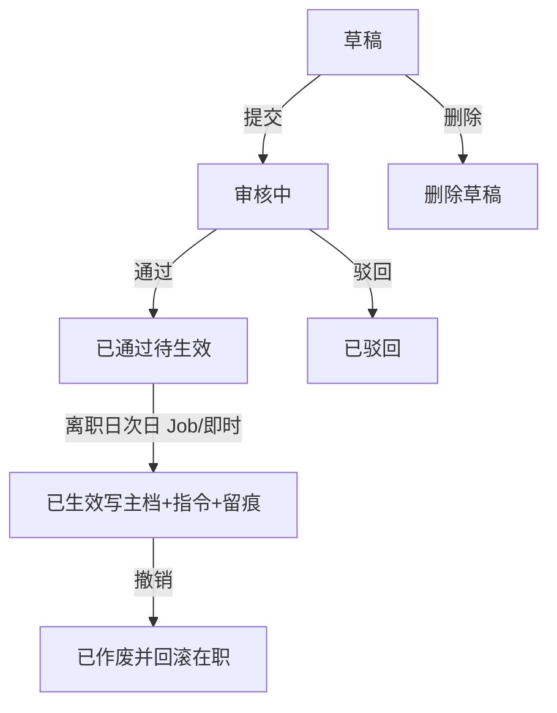

# 离职管理 — 需求与方案总览

> 分析日期：2026-11-10  
> 设计立场：**HR 专家方案**，不以旧系统窗体/字段为约束；旧提取见 [01-field-extract.md](./01-field-extract.md)（仅存档，不作为一期规格）  
> 状态：**已批准**（2026-11-10 修订：同工号复职管理；纠错仅在离职处理·撤销）  
> 平台落点：与异动管理一期同构（独立模块 + 模块内审核 + 到日写回）

---

## 1. 意图与为什么现在做

离职是**有离职日的劳动关系结束事件**：不是人员资料上点一下「离职」，而是一张可审核、按规则到日落地、可恢复、可追溯的业务单。

成功标准：

1. HR 在**离职管理**下完成代码维护、离职办理；在**复职管理**下办理同工号复职。  
2. **离职日当天仍算在职**；系统在**次日**将主档改为离职（全公司统一）。  
3. 审核通过 ≠ 立刻改主档；离职次日生效，**复职日当天**生效。  
4. 薪资结算码在离职生效时写入**指令**，算薪模块后接消费；一期不算薪。  
5. 黑名单仅标记；**再入职（新工号）另案**，不与复职混用。  
6. 选人/列表均受**当前用户管辖部门**约束。

---

## 2. 已确认业务结论

| # | 结论 |
|---|------|
| C1 | 不以旧系统为参考；专家方案 + 对齐本平台异动一期模式 |
| C2 | 全公司统一：**离职日次日生效**（`leave_date + 1`） |
| C3 | 一期审核：**模块内**提交 / 通过 / 驳回；通用审批流程后置 |
| C4 | 薪资：一期落**结算指令**；**算薪后接**，离职服务不改工资单 |
| C5 | 黑名单：仅标记；入职人工判断 |
| C6 | **纠错**＝离职处理内「撤销」；**复职**属停复职管理，**仅服务停职→在职**（2026-11-10） |
| C7 | 选人仅限**当前用户管辖部门**内人员 |
| C8 | 离职后再聘（同工号/新工号）**另案**，不在复职模块 |

---

## 3. 目标 / 非目标 / 反目标

### 3.1 一期目标

| 能力 | 说明 |
|------|------|
| 代码设置 | `LeaveReason` / `LeaveType` / `LeaveSalarySettle`（已落地页签维护） |
| 离职办理 | 开单、模块内审核、次日生效写主档、留痕；误办用**撤销**纠错 |
| 复职管理 | 同工号复职单；当天生效；原离职单保持已生效；写履历 |
| 薪资指令 | 离职生效时按结算码写指令表，供薪酬后接 |
| 列表 | 离职三页签 + 复职三页签；服务端排序；管辖过滤 |
| 黑名单标记 | 单据字段；复职可选清除 |

### 3.2 非目标（一期不做）

| 不做 | 说明 |
|------|------|
| 对接审批流程引擎 | 含 `HrEmpLeaveWfBizHandler` 作正式入口；后置可衔接 |
| 算薪/个税/实发 | 只写指令 |
| 资产/账号/门禁自动回收 | 可备注，无系统闭环 |
| 交接清单工作流引擎 | |
| 批量离职导入 | |
| 多人一张单 | 一单一人 |
| 按厂别不同生效偏移 | 已定全公司 +1 日 |

### 3.3 反目标

- 审核通过当日就把人改成离职（违背 C2）。  
- 未到生效日改主档。  
- 绕过管辖选人。  
- 离职服务直接改工资明细。  
- 黑名单静默禁止入职却无提示、无人工出口。

---

## 4. 菜单与对象

| 菜单 | 职责 |
|------|------|
| 离职原因设置 | 三类码表页签（原因 / 类型 / 薪资结算） |
| 员工离职处理 | 离职单列表 + 办理 |
| （复职已迁至「停复职管理」） | 见 [员工停复职管理/01-需求与方案.md](../员工停复职管理/01-需求与方案.md) |

业务对象：

- **离职单**：谁、哪天离职、类型/原因、薪资结算、是否黑名单。  
- **纠错**：在离职处理对已生效离职单**撤销**；作废单与指令并回滚主档。  
- **薪资结算指令**：离职生效产物；纠错撤销时作废有效指令。  
- **停职/复职**：见停复职管理；**再入职另案**。

---

## 5. 办理主流程（离职）

| 阶段 | 谁 | 可做什么 |
|------|----|----------|
| 草稿 | 发起人 | 改、删、提交 |
| 审核中 | 有审核权限者 | 通过、驳回；明细只读 |
| 待生效 | 系统 | 到「离职日+1」写回；人不可改明细 |
| 已生效 | 有撤销权限者 | 仅撤销（见规则） |
| 已驳回 / 已作废 | — | 只读；不参与在途拦截 |

**生效日定义**：计划生效日 = `leave_date + 1` 个自然日。通过时若计划生效日 ≤ 今天则立即尝试 Apply，否则定时 Job。

**与「离职日」展示**：单据上离职日 = 员工最后一个在职自然日；主档 `emp_lea_date` 建议存**离职日**（业务日），状态切换发生在次日——实现计划中与现有 `hrEmpLeave` 策略对齐并写清列语义。

---

## 6. 复职已迁至停复职管理

> 经典配对为 **停职 ↔ 复职**。详见 [员工停复职管理/01-需求与方案.md](../员工停复职管理/01-需求与方案.md)。  
> 离职处理内的**撤销**仍只做纠错。

---

## 7. 开单字段（专家建议一期）

### 7.1 离职单

| 字段 | 必填 | 说明 |
|------|------|------|
| 单号 | 自动 | 只读 |
| 工号 | 是 | 管辖内输入/选人；带出姓名、部门等 |
| 离职日 | 是 | 最后在职日 |
| 离职类型 | 是 | `LeaveType` |
| 离职原因 | 是 | `LeaveReason` |
| 薪资结算 | 是 | `LeaveSalarySettle`；默认 `NormalPay` |
| 是否黑名单 | 是 | 默认否 |
| 备注 | 否 | |

### 7.2 复职单

见停复职管理文档（对象为停职人员）。

---

## 8. 薪资结算指令（一期契约）

生效成功后写入指令（表名实现计划定，概念如下）：

| 字段 | 说明 |
|------|------|
| emp_id / 来源单号 | |
| leave_date | |
| settle_code | NormalPay / StopPay / AutoNoPay |
| pay_period | 离职日所属薪酬月（发薪主体未建时可为自然月占位） |
| status | 有效 / 已消费 / 已作废 |

算薪语义（后接，本期只文档约定）：

| settle_code | 算薪侧 |
|-------------|--------|
| NormalPay | 计薪至离职日（含） |
| StopPay | 当月停发；可人工解锁补发 |
| AutoNoPay | 当月不发；默认不进补发队列 |

---

## 9. 关键业务规则

| # | 规则 |
|---|------|
| R1 | 审核通过只进待生效；写主档入口为本模块 Apply（非流程 Handler 正式入口）。 |
| R2 | 离职计划生效日 = 离职日 + 1；全公司统一。 |
| R3 | 复职计划生效日 = 复职日当日。 |
| R4 | 一单一人；管辖外不可选。 |
| R5 | 离职开单对象：在职或停职；复职开单对象：已离职（同工号）。 |
| R6 | 同人存在 Draft/InReview/Approved 的离职或复职单 → 禁止再开同类或冲突单。 |
| R7 | 同人已离职后须复职（同工号）或再入职（另案）后才能再开离职。 |
| R8 | 一期允许自审（与异动 R19 一致）；二期可加禁止自审。 |
| R9 | 黑名单不拦截入职 API；人员新增/入职 UI 可提示有标记（二期可增强）。 |
| R10 | 生效写历史（`h_emh_hist`，类型区分离职 LZ / 复职 FZ）。 |
| R11 | 撤销已生效离职：回滚在职并清空离职日；指令作废；若薪资月已关账则提示需薪资手工处理。 |
| R12 | 列表/选人与人员资料同一套组织数据权限。 |

---

## 10. 与现有系统对齐

| 能力 | 落点 |
|------|------|
| 码表 | `code_mstr`：`LeaveReason` / `LeaveType` / `LeaveSalarySettle` |
| 菜单 | 人事管理 → 离职管理（三子菜单已挂） |
| 审核/Job/Apply | 对齐异动 `hr_emp_chg` 模式；独立离职/恢复表（见后续 03） |
| 主档 | `h_emp_mstr`：`emp_state`、`emp_lea_date`、黑名单标记列（列名实现时定） |
| 流程引擎 hrEmpLeave | **不作为一期正式入口**；策略与 Handler 可留作后置 |
| 管辖 | 与人员/异动相同的管辖部门前缀语义 |

---

## 11. 分期交付

| 期次 | 内容 |
|------|------|
| P0 | 表结构、权限、离职/恢复列表与编辑、草稿 CRUD、提交/通过/驳回 |
| P1 | 到日 Job、Apply 写主档与 hist、薪资指令、撤销、拦截规则 |
| P2 | 入职页黑名单提示、与审批流程结合、算薪消费指令 |
| P3 | 交接/权限回收等周边闭环 |

---

## 12. 验收用例（最小集）

1. 缺必填 → 不能提交离职/恢复。  
2. 管辖外员工无法选出。  
3. 通过但离职日+1 在未来 → 主档仍在职；到日后变为离职且有指令。  
4. 通过且计划生效日 ≤ 今天 → 尽快写回。  
5. 同人在途单 → 再开失败。  
6. 已生效离职 → 纠错恢复（填原因）→ 人员回滚；黑名单不自动清。  
7. 驳回 → 不写主档。  
8. 不依赖流程中心可走通离职与纠错。

---

## 13. 落地说明

已批准并完成一期开发。相关脚本：

- `doc/sql/2026-11-10/01-离职管理建表.sql`
- `doc/sql/2026-11-10/02-离职办理与恢复菜单权限.sql`

改条款请标号（C# / R#）。
