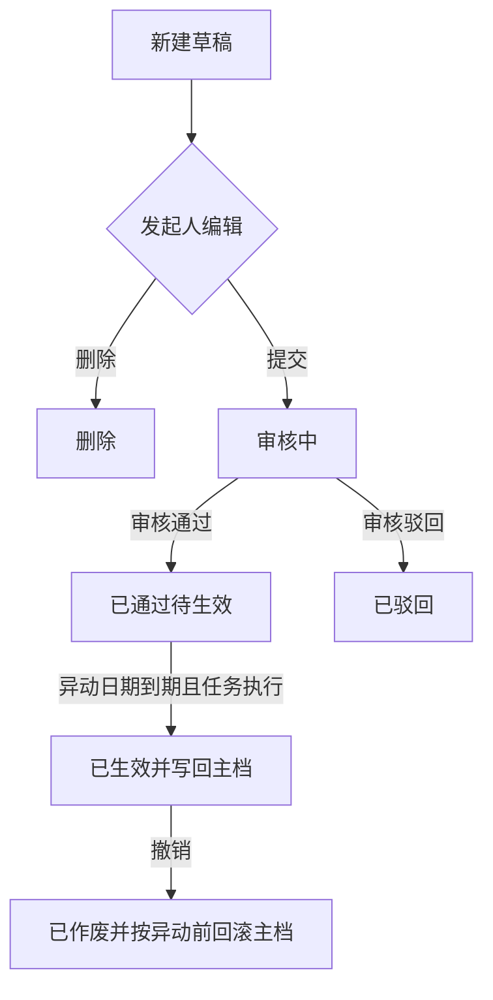

# 异动管理 — 需求与方案总览

> 分析日期：2026-10-20  
> 依据：业务口述确认 + 异动表头截图 + 现有人员资料 / 字段池实现  
> 详细表结构与接口见 [02-数据模型与接口要点.md](./02-数据模型与接口要点.md)

---

## 1. 意图与成功标准

在人事系统内完成员工异动的**开单 → 审核 → 到日写回主档 → 留痕**；需要回退时通过**撤销**恢复主档并作废原单。

成功时：

1. 管理员可维护一份全系统共用的「异动可改字段清单」，字段来自员工资料字段池。
2. HR 可按截图表头开单；表体按清单左右对比填写异动前/后。
3. 审核通过且到达异动日期后，系统自动把「后」值写回 `h_emp_mstr` 对应列。
4. 任意已落库单据可追溯；已生效单不可改，只能撤销回滚。

---

## 2. 已确认需求（业务原话落地）

| # | 规则 |
|---|------|
| R1 | 在系统中发起异动 |
| R2 | 修改哪些员工项目可配置；关联员工资料项目 |
| R3 | 一期至少包含**部门**；一张单可改多个字段（以配置为准） |
| R4 | 新建时异动前/后默认等于当前员工资料，再按需改「后」 |
| R5 | **以异动日期决定写回时机**；须先审核通过，再到日自动写回 |
| R6 | 生效后不可修改；只能**撤销**：按该单「异动前」恢复主档字段，并作废原单 |
| R7 | 本期无独立审批流：模块内**通过 / 驳回** |
| R8 | 存在**审核中**单据时，该员工不允许再发起 |
| R9 | 若已存在异动日期**晚于**本次申请异动日期的单据，不允许发起 |
| R10 | 参与 R8/R9 拦截的状态：草稿、审核中、已通过待生效、已生效；**已作废不参与** |
| R11 | 仅审核人可驳回；仅**已生效**后可走撤销回滚 |
| R12 | 草稿阶段发起人可继续改单、删除草稿 |
| R13 | 表头字段同截图（见 §4）；表体左右两列对比 |
| R14 | 到日写回时**仍按本单「异动后」覆盖主档**，不因期间人员资料被改过而失败或改写「前」值 |

---

## 3. 目标 / 非目标 / 反目标

### 3.1 目标（一期）

- 异动可改字段配置页（勾选/排序，绑定 `hrEmp` 字段池物理字段）。
- 异动单列表（分页 + 列排序）与编辑页。
- 状态：草稿 → 审核中 → 已通过待生效 → 已生效；旁路：驳回、作废（撤销）。
- 定时任务扫描「已通过待生效且异动日期 ≤ 当天」并写回主档。
- 权限按钮：新增/编辑/删除草稿、提交、审核通过、驳回、撤销、字段配置。

### 3.2 非目标（一期不做）

| 不做 | 说明 |
|------|------|
| 多级审批流 / 工作流引擎 | 仅模块内通过/驳回 |
| 多种「异动类型」分套字段 | 全系统一份清单；「异动类别」只是单据分类标签 |
| 批量多人一张单 | 一单一人 |
| 薪资 / 编制 / 考勤联动 | 只写员工主档配置字段 |
| EAV 无实体列 | 配置项必须能映射到 `h_emp_mstr` 已有列（或已支持的物理字段） |
| 与离职模块合并 | 离职另案；表头风格可参考，数据表分开 |

### 3.3 反目标（做成这样也算失败）

- 未审核或未到异动日期就改了主档。
- 生效后仍可改明细导致与主档、历史对不上。
- 撤销不回滚主档或回滚错字段。
- 绕过日期链插入「更早」的异动，打乱时间序。

---

## 4. 界面方案

### 4.1 表头（截图定稿）

| 字段 | 控件 | 规则 |
|------|------|------|
| 异动单号 | 文本 | 自动产生，只读 |
| 工号 | 文本 + 选人 | 必填；选人后带出姓名，并刷新表体前/后默认值 |
| 姓名 | 文本 | 只读带出 |
| 异动日期 | 日期 | 必填；参与发起拦截与写回判断 |
| 异动类别 | 下拉 | 人事代码（建议 `code_field` 如 `EmpChgType`）；示例：晋升 |
| 异动原因 | 文本 | 可空或按实施要求必填（**建造方默认：非必填**） |

### 4.2 表体（左右对比）

```text
┌─────────────────────┬─────────────────────┐
│ 异动前（只读）        │ 异动后（草稿可编）    │
├─────────────────────┼─────────────────────┤
│ 部门：研发一课        │ 部门：[组织选择]      │
│ …配置清单中的其它字段… │ …同上…               │
└─────────────────────┴─────────────────────┘
```

- 行集合 = 当前启用的异动字段配置（按 `sort_no`）。
- 选人 / 打开草稿时：前 = 后 = 主档当前值。
- 控件类型、代码类、组织级联等复用字段池定义（如部门 `ccCode` → cascader，与人员表单一致）。
- 审核中及之后：整单只读（撤销操作为独立动作，不开放改明细）。

### 4.3 列表页

- 建议列：异动单号、工号、姓名、异动日期、异动类别、状态、异动原因、维护信息。
- 筛选：工号/姓名、日期范围、状态、类别。
- 遵守项目列表排序约定（`field` / `order` / `descStr` + `OrderBuilder`）。

### 4.4 配置页

- 「异动可改字段」：从 `hrEmp` 字段池挑选 **physical** 且启用、适合写回的字段；排序；启用/停用。
- 一期种子至少勾选 **部门 `ccCode`**。
- 已出现在历史异动明细中的字段，停用配置时**不影响历史只读展示**；仅影响新开单表体。

---

## 5. 流程（业务视角）



| 阶段 | 谁 | 可做什么 |
|------|----|----------|
| 草稿 | 发起人 | 改、删、提交 |
| 审核中 | 审核人 | 通过、驳回；发起人不可驳回/作废 |
| 已通过待生效 | 系统 | 到日写回；人不可改明细 |
| 已生效 | 有撤销权限者 | 仅撤销回滚 |
| 已驳回 / 已作废 | — | 只读；不参与发起拦截 |

---

## 6. 与现有系统的对齐方式

| 能力 | 复用点 |
|------|--------|
| 员工主档 | `HrEmployee` / `HrEmpService`；部门列 **`cc_code` / `CcCode`**（禁止改名） |
| 字段语义 | `hr_ui_field_def`（`module_code=hrEmp`）的 `field_key`、`db_column`、`control_type`、`code_field` |
| 组织选择 | 与人员表单部门控件同一套（`ccCode` cascader） |
| 异动类别码 | `code_mstr` + `HrCodeMstrService.GetCodeList` |
| 到日写回 | Furion `IJob`（同钉钉同步等定时任务模式），建议短周期扫描 |
| 菜单/权限 | `SysMenu` 种子 + 角色菜单，风格同其它 HR 页 |

**不**把异动可改字段写进 `hr_ui_layout` 的 form 场景冒充布局；异动有独立配置表，只**引用**字段池键。

---

## 7. 建造方默认取舍（可驳回）

以下对话未点名，由方案直接定案，确认时可改：

1. **已驳回**不参与发起拦截；不可再提交，需另开新单（或后续加「复制为新草稿」）。
2. **撤销**仅当该员工不存在「异动日期更晚且未作废」的单据时允许，避免回滚打穿后续已生效异动。
3. 审核通过时若异动日期 **≤ 今天**：进入待生效后由任务尽快写回（也可在通过事务末尾尝试一次写回，任务作补偿）。
4. 提交时校验：配置字段至少保留一行；允许「后」与「前」全相同（仍留痕），是否业务禁止由实施开关，**默认允许**。
5. 异动原因默认非必填；异动类别必填。
6. 模块码建议 `hrEmpChg`；表名前缀 `hr_emp_chg_*`。
7. **同一员工同一异动日期**，在拦截状态集合内仅允许一张单（含本单更新）；R9 之外再禁「同日第二张」。
8. **打开已存草稿**默认展示库中前/后，不自动按主档重置；仅换人、或用户显式「按主档重载」时刷新。
9. **提交时配置已变**（字段停用/不在清单）：提交失败并提示差异，由发起人改草稿后再提，不自动删行、不静默重载。
10. **待生效期间**不禁止人员资料改同一字段；写回不做「主档须等于异动前」校验（见 R14）。撤销仍按本单冻结的「异动前」回滚。

---

## 8. 交付物清单（确认后进入实现计划）

1. SQL：配置表、主表、明细表、（可选）写回日志；菜单权限；类别代码种子；部门字段配置种子。
2. 后端：配置服务、异动单服务、写回 Job、权限特性。
3. 前端：配置页、列表页、编辑页（表头 + 左右表体）、选人。
4. 验收用例：拦截规则、到日写回、撤销回滚、生效后不可改。

---

## 9. 待你确认

业务规则（含 R14 写回覆盖）与建造方默认（§7）已写入本文与 [02](./02-数据模型与接口要点.md)。

请通读后回复是否**批准本方案**。批准后进入实现计划；若有修改，直接标条款号即可。
