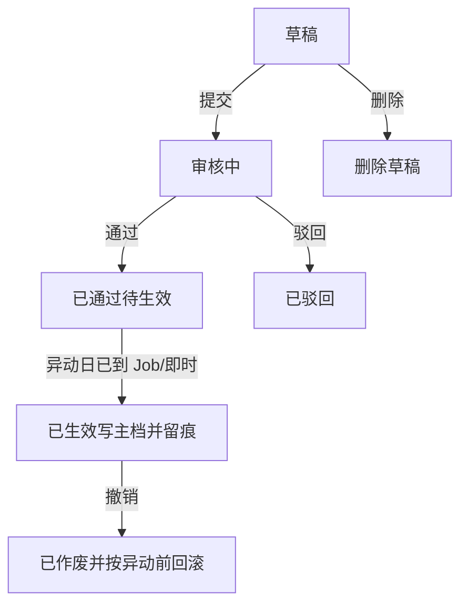

# 异动管理 — 需求与方案总览

> 分析日期：2026-10-29（修订：一期不与审批流程结合）  
> 状态：待业务批准后进入实现计划  
> 配套：[02-数据模型与接口要点.md](./02-数据模型与接口要点.md) · [03-详细设计.md](./03-详细设计.md)

---

## 1. 意图与为什么现在做

人事异动是**有生效日的组织属性变更**：不是改人员资料的「即时编辑」，而是一张可审核、可到日落地、可撤销回滚、可追溯的业务单。

**本期约束（业务已确认）：一期不与通用审批流程引擎结合。**  
审核配置里现有的「员工异动管理」（`hrEmh`）仅作流程引擎测试用途，**不作为本模块正式入口**；与流程打通放后续阶段。

成功标准：

1. HR 在**独立异动模块**开单；**工号、新部门、异动日期**必填。  
2. 模块内审核通过 ≠ 立刻改主档；到达异动日（当日）后系统写回 `h_emp_mstr`。  
3. 生效留痕（建议写 `h_emh_hist`）；已生效可撤销并按「异动前」回滚。  
4. 专用列表可查、可按列排序。

---

## 2. 目标 / 非目标 / 反目标

### 2.1 一期目标

| 能力 | 说明 |
|------|------|
| 开单 | 专用编辑页；选人带出姓名与原部门/原岗位；填异动日、类别、原因、新部门（及新岗位） |
| 审核 | **模块内**提交 / 通过 / 驳回（不走流程引擎） |
| 到日生效 | `chg_date` 当日写回；通过时若已到期立即尝试，否则定时 Job |
| 留痕 | 生效写 `h_emh_hist`（与旧表对齐，便于以后报表） |
| 撤销 | 仅已生效；按本单「异动前」回滚主档并作废 |
| 列表 | 专用异动列表 + 服务端排序 |
| 可改字段 | 一期固定部门 + 岗位；配置表可先种子，二期再做「从字段池勾选」 |

### 2.2 非目标（一期不做）

| 不做 | 说明 |
|------|------|
| **对接审批流程引擎** | 含发起流程、`HrEmhWfBizHandler`、流程表单当正式开单；**后置** |
| 与离职合并 | 离职另案 |
| 薪资/编制/考勤联动 | 只写员工主档约定列 |
| 多人一张单 | 一单一人 |
| 任意 EAV 动态列 | 写回必须落主档物理列 |
| 借调双头任职建模 | 类别标签即可 |
| 分钟级生效 | 按业务日 |

### 2.3 反目标

- 未审核或未到异动日就改主档。  
- 生效后仍可改明细。  
- 撤销不回滚或回滚错字段。  
- 绕过日期链打乱时间序。  
- 一期把测试用的流程异动当成正式业务入口。

---

## 3. 业务对象与必填字段

### 3.1 异动单

**谁**在**哪一天**从**何种组织状态**变为**何种组织状态**，以及类别与原因。

### 3.2 必填（产品硬约束）

| 字段 | 存储 | 规则 |
|------|------|------|
| 工号 | `emp_id` | 必填；选人；带出姓名 |
| 异动日期 | `chg_date` | 必填；当日可写回主档 |
| 部门 | `value_after`（部门行）/ 表头亦可冗余新部门 | **异动后部门必填**；原部门开单只读带出 |

仅调岗不调部门时：新部门仍必填（可与原部门相同）。

### 3.3 一期界面字段

| 字段 | 必填 | 说明 |
|------|------|------|
| 异动单号 | 自动 | 只读 |
| 工号 | 是 | 选人 |
| 姓名 | 带出 | 只读快照 |
| 异动日期 | 是 | |
| 异动类别 | 是 | 码表，建议 `EmpChgType` |
| 异动原因 | 否 | |
| 原部门 / 新部门 | 新部门是 | 左右对比；原只读 |
| 原岗位 / 新岗位 | 新岗位否 | 未填则不改主档岗位 |
| 备注 | 否 | |

类别示例：部门调动、岗位调整、晋升、降职、平调、借调、其它。

### 3.4 后续扩展

- **二期**：`hr_emp_chg_field` 从人员字段池勾选更多可改项 + 左右对比。  
- **流程结合期**：再挂 `biz_type=hrEmh` 与生效策略；本模块单据可作业务明细优先源（见审批文档）。一期表结构预留 `chg_no` / 前后值即可，**不依赖**流程表。

---

## 4. 流程（模块内）

| 阶段 | 谁 | 可做什么 |
|------|----|----------|
| 草稿 | 发起人 | 改、删、提交 |
| 审核中 | 有审核权限者 | 通过、驳回；明细只读 |
| 待生效 | 系统 | 到日写回；人不可改明细 |
| 已生效 | 有撤销权限者 | 仅撤销 |
| 已驳回 / 已作废 | — | 只读；不参与发起拦截 |

---

## 5. 关键业务规则

| # | 规则 |
|---|------|
| R1 | 审核通过只进入待生效；写主档唯一入口为本模块 Apply（非流程 Handler）。 |
| R2 | 异动日**当日**可生效；通过时若 `chg_date≤今天` 立即尝试写回，否则 Job。 |
| R3 | 写回按「异动后」覆盖；**不校验**主档是否仍等于「异动前」。 |
| R4 | 撤销仅已生效；按本单「异动前」回滚实际写过的列。 |
| R5 | 同人存在「审核中或待生效」时禁止再开。 |
| R6 | 存在更晚异动日且未作废的在途/已生效单 → 禁止开更早单。 |
| R7/R13 | 同人同日：在途或已生效均不允许第二张；纠错先撤销再开。 |
| R8 | 撤销时若存在更晚未作废单 → 拒绝。 |
| R9 | 一单一人；工号、异动日期、新部门校验失败不得提交。 |
| R10 | 生效写 `h_emh_hist`。 |
| R11 | 可选字段（如新岗位）为空 → **跳过该列**，不清空主档。 |
| R12 | 允许补录过去的异动日；仍受 R6/R7。 |
| R14 | 专用异动列表（本模块表），不依赖流程实例列表。 |
| R15 | 拦截权威集合 = 本模块单 `status ∈ {Draft, InReview, Approved, Effective}`（已驳回/已作废不计）。 |
| R16 | **一期禁止**从本模块跳转/依赖流程配置中的测试用「员工异动」。 |
| R17 | 列表/选人/审核**沿用人员资料同一套组织数据权限**（有功能权限≠看全库）。 |
| R18 | 选人默认与人员模块「在职」口径一致；补录过去日期时若选人器能选出该人则允许（不另造离职禁开规则）。 |
| R19 | **一期允许自审**（提交人可对自己的单点通过）；二期再加「禁止自审」开关。 |
| R20 | 跨公司调动一期仍**只写** `cc_code` / `post_id`；公司等主档字段不同步（非目标）。 |

---

## 6. 界面方案

### 6.1 列表

列：异动单号、工号、姓名、异动日期、类别、原部门、新部门、状态、维护信息。  
筛选：工号/姓名、日期范围、状态、类别。  
排序：`field` / `order` / `descStr` + `OrderBuilder`。

### 6.2 编辑页

上表头 → 下左右对比（部门、岗位）→ 底栏按状态显隐：保存、提交、通过、驳回、撤销、返回。

### 6.3 配置（一期可简）

- 异动类别：`code_mstr`。  
- 可改字段配置页可二期再做；一期种子固定部门+岗位。

---

## 7. 与现有系统对齐

| 能力 | 落点 |
|------|------|
| 单据 | `hr_emp_chg` + `hr_emp_chg_line`（见 02） |
| 审核 | 本模块 API：Submit / Approve / Reject |
| 到日写回 | 本模块 Apply + Furion `IJob` |
| 主档 | `h_emp_mstr`（`cc_code`、`post_id`） |
| 历史 | `h_emh_hist` |
| 选人/部门 | 与人员资料、查找数据源一致 |
| 流程引擎 / hrEmh 测试配置 | **不接入**；后置 |

平台：Admin.NET + Vue3。

---

## 8. 分期交付

| 期次 | 内容 |
|------|------|
| P0 | 表结构、菜单权限、列表+编辑、草稿 CRUD、提交/通过/驳回 |
| P1 | 到日 Job、Apply 写主档、写 hist、撤销回滚、拦截 R5–R8/R13 |
| P2 | 可改字段配置（字段池）、更多组织属性 |
| P3 | **与审批流程结合**（替换/并存测试用 hrEmh；生效策略复用另案） |

---

## 9. 验收用例（最小集）

1. 缺工号 / 缺异动日期 / 缺新部门 → 不能提交。  
2. 选人带出原部门/原岗位；改新部门保存草稿并提交。  
3. 模块内通过但异动日在未来 → 主档不变；到日后变为新部门。  
4. 通过且日期 ≤ 今天 → 尽快写回；hist 有记录。  
5. 同人审核中/待生效 → 再开失败。  
6. 撤销 → 主档恢复；可再开。  
7. 更晚已生效单存在 → 撤销早单失败。  
8. 驳回 → 不写主档；可再开新单。  
9. 不依赖流程中心即可完成上述路径。

---

## 10. 待你批准

已按你的要求改为：**独立异动模块 + 模块内审核；流程结合后置**（因现有流程里的员工异动仅为测试）。

请确认是否**批准**。批准后出实现计划；改条款请标号。
