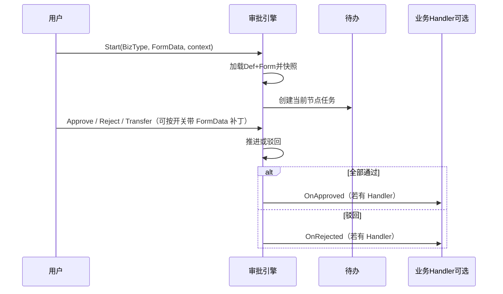

# 审批流程引擎 — 方案设计

> 分析日期：2026-10-20（修订：2026-10-21）  
> 定位：全系统共用审批引擎（多级串审 + 会签/或签 + **按 BizType 可配置表单**）  
> 依据：业务确认「全系统共用」+ 建造方按市面主流（钉钉/飞书/企微/用友类人事审批）给定默认  
> 状态：**待业务确认**（确认前不写产品代码）  
> 已确认增量：审批角色独立建表；成员挂岗位；审核等级；管辖部门；等级顺序升级；`SysUser.JobNum`；一岗多人默认或签；超时 = 流程默认 + 节点可覆盖；**表单按 BizType 可配置（新业务默认 B / FormData）**；**审批中改字段由开关配置**

---

## 1. 意图与成功标准

做一个**流程与表单均可配置**的审批引擎：管理员按业务类型配置表单与多级审批；员工在统一入口发起/待办；引擎负责找人、流转、会签/或签、催办与留痕。新业务**默认不建专用前端页**，表单数据落在引擎实例中；需要写主档时再挂业务 Handler。

成功时：

1. 管理员可配置多套流程定义，绑定到业务类型（如 `hrEmpChange`、`hrLeave`、`hrResign`）。
2. 同一流程可配置多级节点；节点支持**串审**、**会签（全部通过）**、**或签（一人通过）**。
3. 审批人可按「指定人 / **审核等级** / 部门负责人 / 发起人直属上级」解析；细角色做「归属等级 + **管辖部门** + 挂岗位」；`Level` 找人必须结合管辖部门。
4. **按 BizType 可配置审批表单**；新业务默认模式 B（字段与数据在引擎内）；统一「发起 / 待办 / 已办 / 我发起的」用**通用表单页**渲染，不强制每类型开发页面。
5. **审批中能否改表单字段由开关配置**（流程/表单级，可细化到发起人/审批人/节点）。
6. 驳回、撤回、转交规则清晰；全程操作留痕可查。

---

## 2. 与现有能力的关系（建造方结论）

| 现有 | 结论 |
|------|------|
| `Admin.NET.Plugin.DataApproval` | 有表单 JSON 思路，但**无规范的多级实例、待办、会签、等级找人模型**，不作为底座；本引擎自建 `hr_wf_*`，表单能力重做并对齐人事字段/代码类 |
| 钉钉插件同步审批 | 外部流程同步，不是站内引擎 |
| 通用表单 / `HrUiLayout` | **复用交互与控件约定**（字段列表 + 栅格布局 + CodeField），审批表单独立表 `hr_wf_form*`，不混用人事资料布局表 |
| 异动一期 R7 | 「模块内通过/驳回」保留为无流程时的降级；挂引擎后可走模式 A（池字段写回）或仍用业务页作例外 |

**建造方默认：新建独立模块 `HrApproval`（或 `SysApprovalFlow`），不改造 DataApproval 插件。**

---

## 3. 目标 / 非目标 / 反目标

### 3.1 目标（一期）

- 流程**定义**与**实例**分离；开单时快照定义版本与**表单 Schema 版本**，避免改模板影响在途单。
- **按 BizType 配置审批表单**（字段、布局、校验）；新业务默认 **模式 B**（见 §6）。
- 节点能力：开始 → 审批节点（串 / 会签 / 或签）→ 结束；支持条件分支（表达式可读 FormData，见 §7.3）。
- 审批动作：同意、驳回（**默认退回发起人**）、转交、撤回；加签二期。
- 统一待办中心 + 通用表单详情（含进度条与审批操作条）。
- 业务适配器（可选）：`OnApproved` / `OnRejected` / `OnCancelled`；纯 B 类型可无 Handler，仅引擎归档。
- 权限：流程定义 / 表单设计 / 审核等级 / 审批角色 / 待办；菜单仍用 `SysRole`。

### 3.2 非目标（一期不做）

| 不做 | 说明 |
|------|------|
| 可视化自由拖拽 BPMN 大画布 | 一期用「有序列表 + 节点属性」 |
| 复杂网关（包容网关、子流程、循环） | 会签/或签 + 条件跳过已覆盖主流人事场景 |
| 与外部钉钉/企微双写 | 可后接；一期站内闭环 |
| 完整脚本语言 / 跨系统规则引擎 | 条件表达式白名单 |
| 另起 `v-form-designer` 第二套设计器 | 用字段列表 + 栅格（对齐现有 layoutEditor 交互） |
| 用引擎表单替代人事主档 EAV | 主档仍实体字段；引擎 FormData 服务审批单，不替代员工主档建模 |

### 3.3 反目标（做成这样也算失败）

- 每个业务类型都要开发专用审批页才能上线（与「可配置表单」相悖）。
- 每个业务模块各自写一套审批状态机，待办分散。
- 改流程/表单定义后，在途实例审核人或已填数据「突然变了」且无快照。
- 会签未全员同意就推进；或签一人通过后仍卡其他人。
- 引擎在未配置 Handler 的情况下擅自改业务主档。

---

## 4. 核心概念（市面主流对齐）

```text
审批表单方案 (Form)     ← 按 BizType 配置字段与布局
流程定义 (Definition)   ← 绑定 Form；节点：串/会签/或签；审批人规则
  └─ 节点 (Node)
流程实例 (Instance)     ← FormDataJson + 定义/表单快照
  └─ 任务 (Task)        ← 落到具体审批人的待办
操作日志 (ActionLog)
```

| 概念 | 说明 |
|------|------|
| 业务键 | `BizType` + `BizId`；纯 B 类型可由引擎生成 `BizId`（实例 Id）；同一业务单默认禁止并行进行中实例 |
| 串审 / 会签 / 或签 | 同前；一岗多人默认或签 |
| 空节点 | `Level` 沿审核顺序升级；到顶仍无人默认跳过并记日志 |

---

## 5. 审批人解析（建造方默认优先级）

节点上配置一种主规则（一期单规则）：

| 规则 | 语义 | 典型场景 |
|------|------|----------|
| `FixedUser` | 指定用户 Id 列表 | 固定某人 |
| `Level` | **审核等级**：等级 → 管辖覆盖的角色 → 岗位 → 员工 → 用户；空人/超时按 `AuditOrder` 升级 | 部门主管、分部经理… |
| `DeptManager` | 单据/员工所属部门负责人 | 部门内审批 |
| `Reporter` | 发起人或单据员工的直属上级 | 直线经理 |

> 流程只选少量**审核等级**；细角色只做「归属等级 + 管辖部门 + 岗位」。对齐旧系统「审核等级定义 + 角色归属等级」。

### 5.1 审核等级 + 审批角色（两层模型）

**不与** `SysRole` / `SysUserRole` 关联。

```text
审核等级 (hr_wf_level)          ← 流程节点选这个（少量）
  ├─ 审核顺序 AuditOrder
  ├─ 是否职能审核 IsFunctional
  └─ 审批角色 (hr_wf_role)
        ├─ 管辖部门 (hr_wf_role_scope)
        └─ 绑定岗位 (hr_wf_role_post)
              └─ 在岗员工 → SysUser.JobNum → 待办
```

| 要点 | 约定 |
|------|------|
| 等级表 | `hr_wf_level`：编码、名称、`AuditOrder`、`IsFunctional`、启用 |
| 等级示例 | 职员=0、部门主管=1、分部经理=2…；考勤专员/HR经理等 `AuditOrder=99` 且 `IsFunctional=true` |
| 角色表 | `hr_wf_role`：`LevelId`、排序、启用；可选 `ParentId` 仅分类，**不作升级链** |
| 管辖部门 | `hr_wf_role_scope`：`CcCode` + `IncludeChild`；语义对齐用户管辖部门（稳定内码 + 当前层级前缀匹配） |
| 成员 | `hr_wf_role_post` ↔ 员工 `post_id` |
| 用户映射 | **`SysUser.JobNum`** = 员工工号 |
| 一岗多人 | 多人待办，**默认或签** |
| 职能等级 | 仅流程显式选中；不参与 `AuditOrder` 自动升级 |

#### 5.1.1 管辖部门与解析规则（已锁定）

启动上下文须带 `SubjectCcCode`（单据/员工所属部门内码）。

`Level` 解析：等级下启用角色 → **管辖覆盖 `SubjectCcCode`** → 岗位 → 在岗员工 → `JobNum` → 用户。  
未配管辖部门的角色**跳过**。升级后仍用同一 `SubjectCcCode` 过滤。

### 5.2 按审核顺序升级

| 触发 | 行为 |
|------|------|
| **空人** | 升到下一档非职能等级（更大 `AuditOrder`）再解析 |
| **超时** | 关当前待办，升档重派（P2）；有效时限见 §5.3 |
| **到顶仍空** | 默认跳过；可配置挂起 |
| **职能节点** | 不按顺序升级；空人按空节点策略 |

### 5.3 超时升级时限（已锁定）

**流程默认 + 节点可覆盖**（P2 落地；P0/P1 预留字段）。

| 配置位置 | 字段 | 说明 |
|----------|------|------|
| `hr_wf_def` | `DefaultTimeoutHours` | 流程默认；≤0 表示不启用超时升级 |
| `hr_wf_def_node` | `TimeoutHours`（可空） | 有值覆盖流程默认 |

`effectiveTimeout = node.TimeoutHours ?? def.DefaultTimeoutHours`。

启动上下文：

- `ApplicantUserId`、`SubjectEmpId`、**`SubjectCcCode`（Level 必填）**
- `FormData` / `FormVars`：表单值（条件表达式从 FormData 取）

---

## 6. 审批表单（按 BizType 可配置）（已锁定）

### 6.1 为何放进引擎

依赖各业务开发专用页会导致新类型上线慢。引擎内按 **BizType** 维护表单方案 + 通用渲染页，管理员可配字段与布局；**新业务默认模式 B**，不强制先建业务表与前端页。

### 6.2 模式 A / B

| 模式 | 数据落点 | 适用 | 是否默认 |
|------|----------|------|----------|
| **B. 引擎自定义字段** | 字段定义在 `hr_wf_form_field`；值在实例 `FormDataJson` | 请假说明、通用申请、临时审批等 | **新业务默认** |
| **A. 池字段 + 写回** | 字段引用模块字段池；值可同步业务表 | 异动等已有强业务实体 | 按需；需 Handler |

同一 BizType 选定一种主模式；A 可在 B 之外增加「映射写回」，不改变「待办走通用页」的默认体验。

### 6.3 表单方案与流程的关系

```text
BizType
  └─ hr_wf_form（表单方案，可版本）
流程定义 hr_wf_def
  ├─ BizType、FormId
  ├─ 编辑开关（见 §6.5）
  └─ 节点列表（审批人，不配字段清单）
实例 hr_wf_inst
  ├─ FormSchemaSnapshot（开单时表单结构快照）
  └─ FormDataJson
```

- 流程管「谁审」；表单管「填什么」。  
- 开单时快照 Schema + 写入 FormData，改表单设计不影响在途已填结构/值语义。

### 6.4 字段与控件（一期）

自定义字段（模式 B）支持：单行/多行文本、数字、日期、下拉（`CodeField` → 人事代码）、附件、人员、部门（`CcCode`）。  
布局：字段排序、分组、占位栅格、必填、默认只读标记；交互对齐现有 layoutEditor，**不上**独立可视化表单大画布。

### 6.5 审批中改字段（开关配置）（已锁定）

| 配置项 | 位置 | 默认 | 说明 |
|--------|------|------|------|
| `AllowEditWhileRunning` | 流程定义或表单方案 | **关** | 总开关；关则审批中业务字段只读（审批意见除外） |
| `EditByApplicant` | 同上（总开关开时生效） | 关 | 审批中发起人可否改 FormData |
| `EditByAssignee` | 同上 | 关 | 当前待办审批人可否改 FormData |
| `EditableNodeKeys`（可选 P1） | 节点或表单字段级 | 空 | 仅这些节点允许编辑；空表示不限制节点（仍受上表约束） |

运行时：通用详情页根据实例状态、当前用户身份、上述开关计算每字段 `readonly`。  
**驳回后**：发起人重新编辑再提交——与「驳回退回可编辑」一致，**不依赖** `AllowEditWhileRunning`（驳回后实例已非 Running 或业务约定可编）。

### 6.6 发起与待办 UI

| 入口 | 行为 |
|------|------|
| 发起申请 | 选 BizType → 加载表单方案 → 填写 → `Start`（含 FormData、SubjectCcCode 等） |
| 我的待办 | 打开**通用表单详情**（Schema 快照 + FormData + 进度 + 同意/驳回/转交） |
| 例外 | 极少数可配 `RenderMode=CustomUrl` 跳业务定制页（非默认） |

---

## 7. 流程运转

### 7.1 主路径



### 7.2 实例状态

| 状态 | 含义 |
|------|------|
| `Running` | 审批中 |
| `Approved` | 全部通过（终态） |
| `Rejected` | 已驳回（终态） |
| `Cancelled` | 已撤销/作废（终态） |
| `Suspended` | 挂起（可选） |

纯 B：业务状态即实例状态（或仅引擎侧）。有 Handler 时业务表状态由回调维护；引擎**不擅自写主档**。

### 7.3 条件与跳过

- 节点启用条件：对 **FormData**（及上下文）做等于/包含/比较（如 `leaveDays > 3`）。
- 不满足则跳过；表达式白名单解析，不做完整脚本。

### 7.4 驳回 / 撤回 / 转交

| 动作 | 规则 |
|------|------|
| 驳回 | 默认退回发起人，`Rejected`；发起人可改表单后视业务重新发起或复活策略（一期默认重新 `Start` 或配置「驳回可再提交」） |
| 撤回 | 发起人；`Running` 且尚无人同意 → `Cancelled` |
| 转交 | 当前处理人转他人 |
| 意见 | 同意可空；驳回必填 |

---

## 8. 数据模型（逻辑表）

命名前缀 **`hr_wf_`**，Application 层 HR 服务下。

| 表 | 作用 |
|----|------|
| `hr_wf_level` | 审核等级 |
| `hr_wf_role` | 审批角色（`LevelId`） |
| `hr_wf_role_scope` | 角色管辖部门 |
| `hr_wf_role_post` | 角色–岗位 |
| `hr_wf_form` | 审批表单方案：BizType、编码、名称、版本、模式(A/B)、启用 |
| `hr_wf_form_field` | 表单字段：FieldKey、Label、控件、必填、排序、分组、CodeField、Source(Pool/Custom) 等 |
| `hr_wf_def` | 流程定义：BizType、**FormId**、编辑开关字段、`DefaultTimeoutHours`… |
| `hr_wf_def_node` | 定义节点 |
| `hr_wf_inst` | 实例：快照、**FormDataJson**、**FormSchemaSnapshot**、状态、上下文 |
| `hr_wf_task` | 任务 |
| `hr_wf_action_log` | 审计（含等级升级、表单字段变更若开启编辑） |

要点：

- 启动时快照节点定义 + 表单 Schema。  
- `Level` 找人：等级 → 管辖角色 → 岗位 → `JobNum`。  
- FormData 变更（若开关允许）写审计。

---

## 9. 业务挂接方式

```csharp
public interface IHrWfBizHandler
{
    string BizType { get; }
    Task OnApprovedAsync(HrWfCallback ctx);   // ctx 含 FormData
    Task OnRejectedAsync(HrWfCallback ctx);
    Task OnCancelledAsync(HrWfCallback ctx);
}
```

| 类型 | 职责 |
|------|------|
| **纯 B（默认）** | 可不注册 Handler；终态仅引擎归档；列表/导出读实例 |
| **需写主档 / 模式 A** | 注册 Handler；从 FormData 映射写业务表；生效规则仍在业务模块 |

未配置流程定义时：可自动通过并回调，或返回无流程由业务降级（与前一致）。

---

## 10. 界面方案（一期）

| 页面 | 说明 |
|------|------|
| 审核等级定义 | 名称、审核顺序、是否职能审核 |
| 审批角色维护 | 归属等级、管辖部门、绑定岗位 |
| **审批表单设计** | 按 BizType 维护字段/布局；模式 B 自定义字段；模式 A 勾选池字段 |
| 流程定义列表/编辑 | 绑定表单、编辑开关、节点（等级等）、超时 |
| **发起申请** | 通用表单页 |
| 我的待办 / 已办 / 我发起的 | 列表 + **通用表单详情**（进度 + 操作条） |

---

## 11. 权限与安全

- 菜单：表单设计、流程定义、等级/角色、待办中心。  
- 处理任务：`AssigneeId == 当前用户`。  
- 改 FormData：校验 §6.5 开关与身份。  
- 管理员干预——二期。

---

## 12. 分期建议

| 期次 | 交付 |
|------|------|
| **P0** | 等级/角色/管辖/岗位 + 流程定义 + **表单方案 B** + FormData + 通用发起/待办 + Start/Approve/Reject；`Level` 找人 + 空人按 `AuditOrder` 升级；编辑总开关 |
| **P1** | 会签/或签、转交、撤回、条件读 FormData、快照完善、编辑细化（发起人/审批人/节点）、附件与部门控件 |
| **P2** | 超时升级与催办、模式 A 写回试点、加签、管理员干预、消息/钉钉 |

---

## 13. 验收清单（P0+P1）

- [ ] 同一 `BizType` 可配置多级节点并正确串行推进  
- [ ] 会签 / 或签行为正确  
- [ ] 改定义/表单不影响在途快照  
- [ ] 驳回后发起人可改表单（按驳回规则）  
- [ ] 待办仅所属人可审批操作  
- [ ] 无 Handler 时引擎不写业务主档  
- [ ] 流程按审核等级配置；找人结合管辖部门  
- [ ] 一岗多人默认或签  
- [ ] 空人按 `AuditOrder` 升级（含管辖过滤）  
- [ ] **按 BizType 可配表单；新类型可用 B 模式零定制页上线**  
- [ ] **`AllowEditWhileRunning` 等开关控制审批中改字段**  

---

## 14. 建造方已做决定（可推翻）

1. 新建 `hr_wf_*` 引擎，不复用 DataApproval 插件。  
2. 定义用节点列表，不做 BPMN 画布。  
3. 审批人：指定人 / **审核等级** / 部门负责人 / 直属上级；找人结合**管辖部门**。  
4. 升级按等级 `AuditOrder`；职能等级不参与顺序升级。  
5. `SysUser.JobNum` 映射员工；一岗多人默认或签。  
6. 超时：流程默认 + 节点可覆盖（P2）。  
7. **审批表单按 BizType 可配置**；**新业务默认模式 B（FormData）**；通用发起/待办页。  
8. **审批中改字段由开关配置**（默认关；可配发起人/审批人等）。  
9. 驳回默认退回发起人；无流程可降级。  
10. 一期不做加签、不做外部 IM 双写。  

---

## 15. 确认状态

以下已锁定（含 2026-10-21 表单增量）：角色/岗位/管辖部门、审核等级与 AuditOrder 升级、`JobNum`、或签、超时粒度、**按 BizType 可配置表单、新业务默认 B、审批中编辑可开关**。  

下一份文档：[03-表字段与接口契约.md](./03-表字段与接口契约.md)（逐表字段、接口契约、试点 `hrWfGeneral`）。确认前不写产品代码。
