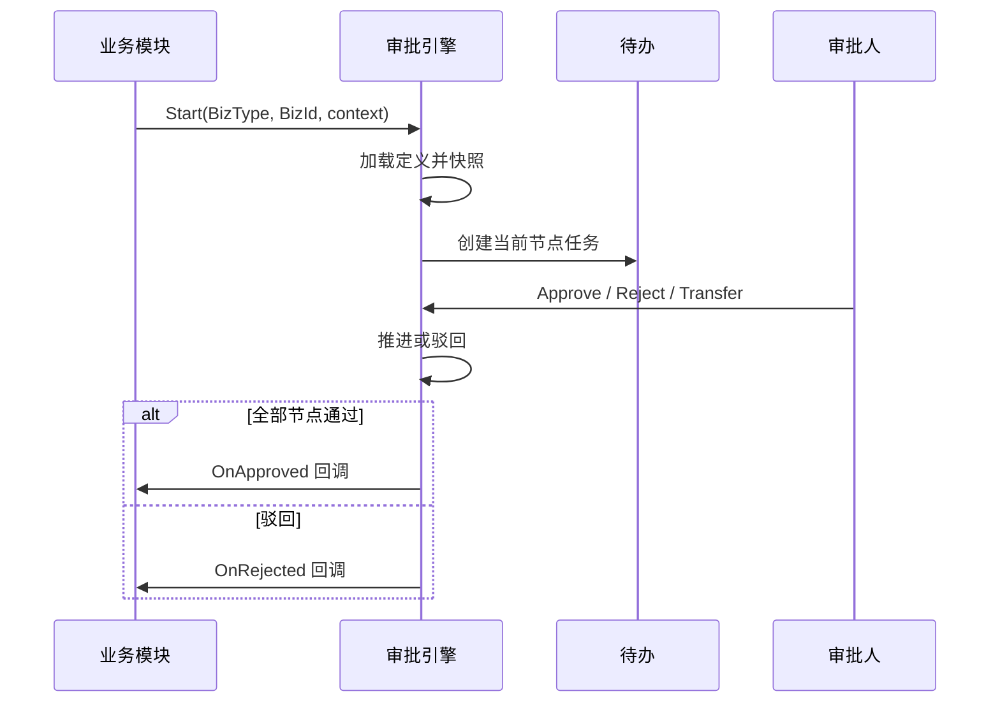

# 审批流程引擎 — 方案设计

> 分析日期：2026-10-20  
> 定位：全系统共用审批引擎（多级串审 + 会签/或签）  
> 依据：业务确认「全系统共用」+ 建造方按市面主流（钉钉/飞书/企微/用友类人事审批）给定默认  
> 状态：**待业务确认**（确认前不写产品代码）

---

## 1. 意图与成功标准

做一个**与业务单据解耦**的审批引擎：任意人事/业务模块提交单据后，只传入「业务类型 + 业务单 Id + 摘要 + 可选上下文」，引擎负责找人、多级流转、会签/或签、催办与留痕；业务模块只在「终态回调」里落自己的业务状态。

成功时：

1. 管理员可配置多套流程定义，绑定到业务类型（如 `hrEmpChange`、`hrLeave`、`hrResign`）。
2. 同一流程可配置多级节点；节点支持**串审**、**会签（全部通过）**、**或签（一人通过）**。
3. 审批人可按「指定人 / 角色 / 部门负责人 / 发起人直属上级」解析（一期以这四类为主）。
4. 员工有统一「我的待办 / 我的已办 / 我发起的」；业务页只显示当前审批进度，不各自造审批 UI。
5. 驳回、撤回、转交规则清晰；全程操作留痕可查。

---

## 2. 与现有能力的关系（建造方结论）

| 现有 | 结论 |
|------|------|
| `Admin.NET.Plugin.DataApproval` | 偏「表单 JSON + 流程 JSON + HTTP 中间件拦截」的数据审批插件，**无规范的多级实例、待办、会签模型**，不建议作为人事审批引擎底座 |
| 钉钉插件同步审批 | 外部流程同步，不是站内引擎 |
| 异动一期 R7 | 「模块内通过/驳回」保留为**无流程定义时的降级路径**；挂上引擎后走引擎终态回调 |

**建造方默认：新建独立模块 `HrApproval`（或 `SysApprovalFlow`），不改造 DataApproval 插件。**

---

## 3. 目标 / 非目标 / 反目标

### 3.1 目标（一期）

- 流程**定义**（模板）与流程**实例**（运行）分离；开单时快照定义版本，避免改模板影响在途单。
- 节点能力：开始 → 审批节点（串 / 会签 / 或签）→ 结束；支持条件分支（简单表达式，见 §6.3）。
- 审批动作：同意、驳回（退回发起人 / 退回上一节点，**默认退回发起人**）、转交、撤回（仅发起人且下一节点无人已审时）、加签（**二期**，一期可先不做）。
- 统一待办中心 + 业务单详情内嵌进度条。
- 业务适配器接口：`Start` / `OnApproved` / `OnRejected` / `OnCancelled`。
- 权限：流程定义维护、待办处理；与现有角色菜单一致。

### 3.2 非目标（一期不做）

| 不做 | 说明 |
|------|------|
| 可视化自由拖拽 BPMN 大画布 | 一期用「有序列表 + 节点属性」配置，够用即可 |
| 复杂网关（包容网关、子流程、循环） | 会签/或签 + 条件跳过已覆盖 80% 人事场景 |
| 与外部钉钉/企微双写 | 可后接；一期站内闭环 |
| 金额/编制等跨系统会签规则引擎 | 条件表达式保持简单 |
| 替代业务表单设计 | 表单仍在各业务模块 / 字段池 |

### 3.3 反目标（做成这样也算失败）

- 每个业务模块各自写一套审批状态机，待办分散。
- 改流程定义后，在途实例审核人「突然变了」且无快照。
- 会签未全部通过就推进下一节点；或签一人通过后仍卡其他人。
- 引擎直接改业务主档，绕过业务模块自己的生效/写回规则。

---

## 4. 核心概念（市面主流对齐）

```text
流程定义 (Definition)
  └─ 节点 (Node)：串审 / 会签 / 或签；审批人规则
流程实例 (Instance)  ← 某张业务单启动后产生
  └─ 任务 (Task)    ← 落到具体审批人的待办
操作日志 (ActionLog)
```

| 概念 | 说明 |
|------|------|
| 业务键 | `BizType` + `BizId` 唯一绑定一张业务单；同一业务单同时只允许一个进行中的实例（可配置，**默认禁止并行实例**） |
| 串审节点 | 解析出 N 人时：**默认取第一人**；若配置「多人依次」则按序一人审完再下一人（一期建议节点内只解析到 1 人，多人用会签/或签表达） |
| 会签（AND） | 节点内全部待办同意 → 节点通过；任一人驳回 → 按驳回策略处理 |
| 或签（OR） | 任一人同意 → 节点通过并取消同节点其余待办；任一人驳回 → 同会签驳回策略 |
| 空节点 | 解析不到审批人时：**默认自动跳过并记日志**（可配置为「挂起待管理员指定」） |

---

## 5. 审批人解析（建造方默认优先级）

节点上配置一种主规则（可扩展组合，一期单规则）：

| 规则 | 语义 | 典型场景 |
|------|------|----------|
| `FixedUser` | 指定用户 Id 列表 | 固定 HR 专员 |
| `Role` | 角色下用户；可选「限本部门/本组织」过滤 | 人事管理员 |
| `DeptManager` | 业务单据所属部门（或员工所在部门）的负责人 | 部门内审批 |
| `Reporter` | 发起人（或单据员工）的直属上级 | 直线经理 |

**组织汇报线 vs 固定节点：两者都要。**  
定义层用「节点序列」表达固定链路（人事 → 部门负责人 → 分管）；节点内部用 `DeptManager` / `Reporter` 动态找人。这是钉钉/飞书人事审批的主流做法，比纯自动爬汇报线更可控。

上下文（启动时由业务传入，写入实例）：

- `ApplicantUserId`：发起人  
- `SubjectEmpId` / 工号：被操作员工（异动/离职常用）  
- `OrgId` / `DeptId`：用于部门负责人解析  
- `FormVars`：简单条件用的键值（如异动类别、是否跨部门）

---

## 6. 流程运转

### 6.1 主路径



### 6.2 实例状态

| 状态 | 含义 |
|------|------|
| `Running` | 审批中 |
| `Approved` | 全部通过（终态） |
| `Rejected` | 已驳回（终态） |
| `Cancelled` | 已撤销/作废（终态） |
| `Suspended` | 挂起（空审批人待指定等，一期可选） |

业务单据自身状态仍由业务模块维护（如异动的「审核中 / 已通过待生效」）；引擎只通过回调通知，**不直接写业务表业务字段**。

### 6.3 条件与跳过（一期简化）

- 节点可配「启用条件」：对 `FormVars` 做等于/包含判断（如 `ChangeType == CrossDept`）。
- 不满足则跳过该节点。
- **不做**完整脚本语言；表达式白名单由引擎解析。

### 6.4 驳回 / 撤回 / 转交（建造方默认）

| 动作 | 规则 |
|------|------|
| 驳回 | 默认**退回发起人**，实例 `Rejected`，业务回调后单据回到可编辑；不默认「驳回后从中间节点续审」 |
| 撤回 | 发起人可撤；条件：实例 `Running` 且**尚无任何人同意过**（或仅当前第一节点无人处理）。撤回 → `Cancelled` |
| 转交 | 当前任务处理人可将本人任务转给另一用户；原任务关闭，新任务继承节点 |
| 同意意见 | 可空；驳回意见**必填** |

---

## 7. 数据模型（逻辑表）

命名前缀建议：`hr_wf_`（人事域）或 `sys_wf_`（若明确平台级）。**建造方默认：`hr_wf_`，放在 Application 层 HR 服务下，便于与员工/组织解析复用。**

| 表 | 作用 |
|----|------|
| `hr_wf_def` | 流程定义头：编码、名称、BizType、启用、版本号 |
| `hr_wf_def_node` | 定义节点：序号、名称、模式(serial/and/or)、审批人规则 JSON、条件 JSON |
| `hr_wf_inst` | 实例：DefId、版本快照、BizType、BizId、状态、当前节点、上下文 JSON |
| `hr_wf_task` | 任务：InstId、NodeKey、处理人、状态(pending/done/cancelled)、动作、意见、时间 |
| `hr_wf_action_log` | 审计：谁在何时对哪实例做了什么（含系统自动跳过） |

要点：

- 启动时把当时 `def_node` 列表**序列化进** `hr_wf_inst.SnapshotJson`（或复制到 `hr_wf_inst_node`），保证在途稳定。
- `BizType + BizId` 唯一进行中实例（部分唯一索引或应用层校验）。

---

## 8. 业务挂接方式

```csharp
// 概念接口（实现名以落地为准）
public interface IHrWfBizHandler
{
    string BizType { get; }
    Task OnApprovedAsync(HrWfCallback ctx);
    Task OnRejectedAsync(HrWfCallback ctx);
    Task OnCancelledAsync(HrWfCallback ctx);
}
```

业务模块职责：

1. 提交前校验本业务规则（如异动 R8/R9）。  
2. 调 `HrWfService.StartAsync(...)`。  
3. 实现 Handler：把本单状态改为「已通过 / 已驳回 / 已作废」。  
4. **生效写主档等仍留在业务模块**（异动到日写回不进引擎）。

未配置流程定义时：

- **建造方默认**：`Start` 直接视为通过并回调 `OnApproved`（或返回「无流程」由业务走旧的单级审核）。异动一期可继续用模块内按钮，直到配置了 `hrEmpChange` 流程。

---

## 9. 界面方案（一期）

| 页面 | 说明 |
|------|------|
| 流程定义列表 | 分页 + 列排序；启用/停用 |
| 流程定义编辑 | 基本信息 + 节点有序列表；节点上选模式与审批人规则 |
| 我的待办 | 列表：单号摘要、业务类型、发起人、到达时间；操作同意/驳回/转交 |
| 我的已办 / 我发起的 | 只读列表 + 跳转业务详情 |
| 业务单内嵌 | 进度时间轴（节点名、人、结果、时间） |

待办点击后：优先打开**业务详情只读页**（带审批操作条），避免引擎自己复制表单。

---

## 10. 权限与安全

- 菜单：流程定义、待办中心（可挂在「人事管理」或「工作台」）。  
- 接口层校验：处理任务必须是任务当前 `AssigneeId == 当前用户`（转交后以新人为准）。  
- 管理员可「指定审批人 / 跳过节点」——**二期**；一期仅通过改定义 + 转交解决。

---

## 11. 分期建议

| 期次 | 交付 |
|------|------|
| **P0** | 表结构 + 定义 CRUD + Start/Approve/Reject + 待办列表 + 一个试点业务（建议异动或最简单的演示单） |
| **P1** | 会签/或签、转交、撤回、条件跳过、实例快照、业务内嵌进度 |
| **P2** | 加签、管理员干预、超时催办、消息通知、与钉钉待办同步 |

---

## 12. 验收清单（P0+P1）

- [ ] 同一 `BizType` 可配置多级节点并正确串行推进  
- [ ] 会签：未全员同意不进入下一节点；或签：一人同意即推进并取消其余待办  
- [ ] 改定义不影响已启动实例的节点与审批人快照  
- [ ] 驳回后退回业务可编辑；引擎为 `Rejected`  
- [ ] 待办仅任务所属人可操作  
- [ ] 业务终态只通过回调变更，引擎不直接改业务主档  

---

## 13. 建造方已做决定（可推翻）

1. 新建 `hr_wf_*` 引擎，不复用 DataApproval 插件。  
2. 定义用节点列表，不做 BPMN 画布。  
3. 审批人规则：指定人 / 角色 / 部门负责人 / 直属上级。  
4. 驳回默认退回发起人；空审批人默认跳过。  
5. 无流程定义时可由业务降级为单级审核或自动通过。  
6. 一期不做加签、不做外部 IM 双写。  

---

## 14. 待你确认后才锁定的点

确认本方案后，下一份文档再写详细表字段、接口契约与首个挂接业务的改造清单（`writing-plans`）。确认前不写产品代码。
